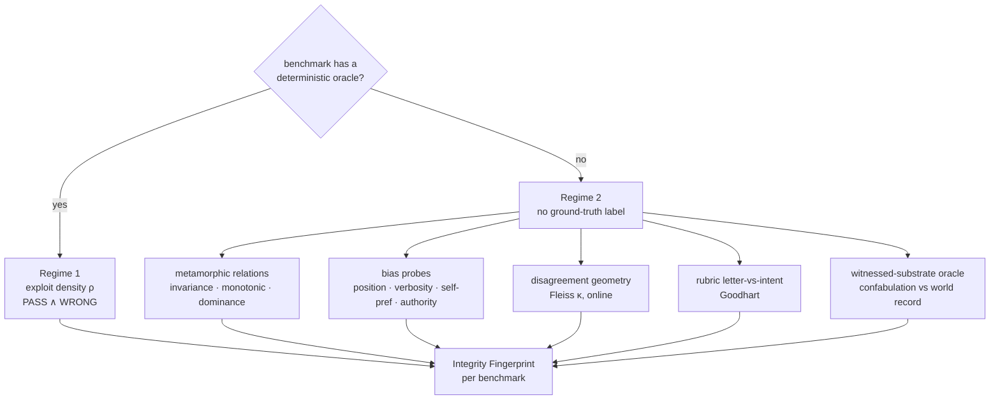
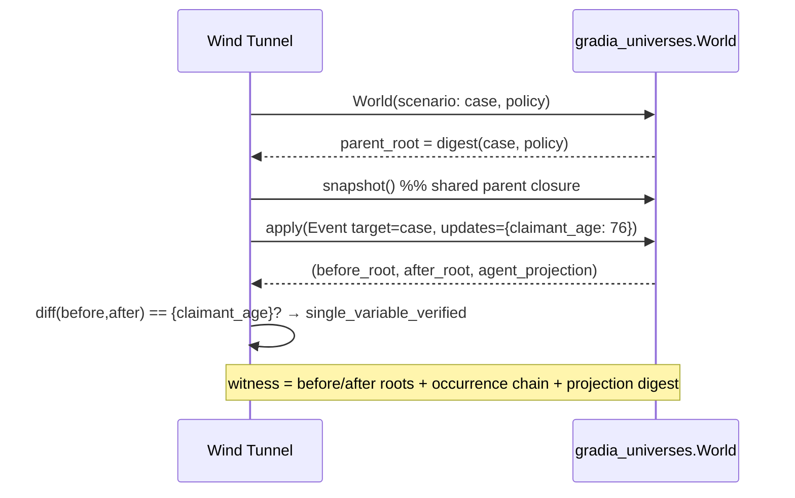

> **Pre-results boundary (unchanged).** This document states *design and method*. It
> reports **no empirical result** about any model or benchmark. Regime 1 (oracle-backed)
> is implemented and property-tested; Regime 2 (oracle-less) is formalized here and is the
> next instrument to build and preregister. Nothing below claims a benchmark is broken or
> a model is weak — those are questions the runs answer, under a frozen preregistration.

---

## A. Why this expansion — the frontier is going oracle-less

The original Wind Tunnel scoped itself to **oracle benchmarks**: those whose correctness
is decided by a deterministic checker (numeric equality, unit tests, answer key). That
scope is what makes the method rigorous — every exploit is confirmed with *zero human
labels*. But it is also a limitation the paper already names (§16: "open-ended grading is
future work"), and it is exactly the direction the frontier is moving.

The hypothesis behind this expansion, stated plainly:

> **Most of the newest, most economically-relevant benchmarks have no oracle.** They are
> scored by an **LLM judge** or a **rubric grader** — because the tasks (knowledge work,
> agentic workflows, professional judgment) have no short checkable answer. So the
> question is not only "can we break the scorers that *have* an oracle?" It is: **if a
> benchmark has no ground-truth oracle, how is it being measured at all — and how do we
> audit and attack *that*?**

This is the more important question, because an oracle-less scorer is *more* gameable and
*harder* to audit, and it is what a growing share of frontier reporting now relies on. The
contribution of this expansion is a method that audits both kinds under one framework, and
a **ground-truth backstop for the oracle-less case that only a witnessed universe can
provide.**

---

## B. The trust chain — why every number is earned

Before the method, the discipline. The Wind Tunnel is built so that a skeptical reader
trusts each number *without trusting us*. Seven links, each fail-closed:

1. **Preregistration freeze.** The design — targets, transforms, oracle rules, judge
   architectures, hypotheses with committed directions, spend cap — is written to a
   canonical JSON, **self-digested and git-pinned**, and frozen *before any run*. The
   verifier recomputes the digest and refuses a mismatch. (Your frozen file:
   `preregistration_sha256 = 921d6cda…`, `git_dirty = false`.)
2. **Fail-closed gates.** Any schema mismatch, any contract whose version wasn't bumped
   and re-frozen, any spend over cap → the run halts. Silence is never a pass.
3. **The oracle backstop.** Ground truth is a deterministic machine check, not our
   opinion. In Regime 2, where no such check exists, the "oracle" is replaced by
   *relations that must hold regardless of truth* (below) — never by our judgment.
4. **Threat rungs, never pooled.** L0 (natural) / L1 (metamorphic) / L2 (adaptive search)
   / L3 (patch-aware) are reported **separately**; no headline number mixes them.
5. **Patch-and-re-attack with an autoimmunity guard.** Every repair reports what it
   *closed* (Δ⁺), what correct answers it *newly broke* (Δ⁻), and whether it *generalized*
   (γ). A patch that breaks correct answers past a pre-fixed budget is rejected.
6. **Causal claims only from controlled interventions.** A slice is a *cause* only when it
   comes from a true factorial or a **witnessed single-variable fork** (§F). Observational
   clusters are labeled hypothesis-generating, never causal.
7. **Tamper-evident evidence + a hidden vault.** Every episode is a hash-chained receipt;
   every reported aggregate is **recomputable offline** from `frames.ndjson`; the hidden
   regression suite's empty head is committed at freeze, so the fixed set cannot be curated
   after the fact. *The writeup asserts nothing; it derives everything.*

That chain is the product. The benchmarks are just where we point it.

---

## C. Regime 1 — oracle-backed auditing (recap)

Where a deterministic oracle `t : A×X → {CORRECT, WRONG}` exists, an **exploit** is an
answer the scorer passes and the oracle proves wrong: `J_θ(a,x)=PASS ∧ t(a,x)=WRONG`.
We manufacture exploits by applying a truth-breaking **transform** to a verified-correct
answer, with a machine-checkable witness (`final_answer_corruption`, `authoritative_wrong`,
`keyword_inflation`, `choice_corruption`, `subtle_bug`). The headline metric is **exploit
density** ρ per rung/transform/benchmark. This is fully implemented and tested.

Applies to: GSM8K, MATH, GPQA-Diamond, HumanEval, SWE-bench Verified — **and the
machine-checkable subset of HLE** (multiple-choice / exact-answer items), which lets a
single frontier benchmark be audited in Regime 1 while its free-response half is a Regime-2
target.

---

## D. Regime 2 — oracle-less auditing (the new contribution)

When the scorer is an LLM judge or rubric grader and there is **no** ground-truth checker,
`t` is undefined, so `PASS ∧ WRONG` cannot be computed. The move is to replace the missing
oracle with **five families of oracle-substitute** — properties whose violation is a
scorer defect *regardless of the unknown ground truth*, each machine-checkable:

**D.1 Metamorphic relations (the core substitute).** Instead of "is this answer correct?"
we ask "did the verdict move when it provably shouldn't have — or fail to move when it
provably should?" Three relation types, no labels needed:
- **Invariance:** apply a *semantics-preserving* transform to a fixed answer (paraphrase,
  reorder independent steps, reformat). The verdict/score must not change. `Δverdict ≠ 0`
  ⇒ an **instability defect**.
- **Monotonic degradation:** apply a *semantics-degrading* transform (delete a required
  step, inject an error the rubric explicitly covers). The score must not *rise*.
  `score↑` ⇒ a **rewarded-worse defect**.
- **Dominance:** if answer A covers every rubric criterion B covers and strictly more,
  then `J(A) ≥ J(B)`. A violation is a **ordering defect**.

**D.2 Bias probes (known judge failure modes, all oracle-free).** Position/order bias
(swap A/B in pairwise, permute option or rubric-criterion order → verdict must be
invariant); verbosity/length bias (pad with fluent irrelevance → score must not rise);
self-preference bias (does the judge favor its own model family?); authority/format bias
(confident tone, citation-shaped text, "Final answer:" scaffolding → score must not rise
absent substance). These reuse the Regime-1 transforms (`authoritative_wrong`,
`keyword_inflation`) as **invariance-violation probes** rather than PASS∧WRONG events.

**D.3 Judge-disagreement geometry (an online reliability detector).** Run each item
through K judge architectures/models and measure agreement (Fleiss' κ). *Our program has
already observed κ = 0.151 on a real evaluation* — near-chance agreement. High-disagreement
regions are where the benchmark's measurement is meaningless, and where exploits should
concentrate. This is an **oracle-free early-warning signal** that needs no attack at all.

**D.4 Rubric letter-vs-intent attacks (Goodhart, made concrete).** For a rubric grader,
construct an answer that satisfies every *criterion* while failing the task's *intent*. If
the grader passes it and a metamorphic relation says it is no better (or worse), the
contradiction is the witness — no ground truth required.

**D.5 The witnessed-substrate partial oracle (the program-unique bridge).** See §E — this
is the move that reintroduces ground truth exactly where oracle-less benchmarks lack it.

**Regime-2 metrics (the integrity fingerprint of an oracle-less scorer):** invariance-
violation rate, monotonicity-violation rate, bias sensitivity (per bias type), disagreement
κ and disagreement-conditioned exploitability, rubric-Goodhart rate, and — where the task
runs in a universe — the **witnessed-confabulation rate**. Same rungs (L0–L3), same
adversary panel; only the "was this an exploit?" test changes from *oracle* to *relation*.

---

## E. The witnessed-substrate partial oracle — ground truth where there was none

Here is the piece **only this program can do.** For an *agentic* or *environment* task —
where the model acts in a world rather than emitting a short answer — quality may be
judge-scored, but the **environment itself is ground truth for factual claims.** The Gradia
universe records, per step, the **agent-visible projection** (what the agent was actually
shown) and the **world roots** (what state the world actually reached), hash-chained.

So even with no quality oracle, we can mechanically prove a specific, damning class of
failure: the model **asserts something the witnessed record contradicts** — it claims it
verified a document it was never shown, cites a value the world never held, reports an
action whose occurrence the chain does not contain. That is **confabulation, witnessed** —
provably wrong, no human, no quality judgment. It converts a fraction of "unjudgeable"
items into oracle-decidable failures, and it is a benchmark-independent detector the
witnessed/branchable substrate uniquely enables. (This is the P2 "provable confabulation"
idea, promoted here to a load-bearing method.)

The consequence for the field: *even the oracle-less frontier benchmarks can be given a
partial oracle* — if they run on a witnessed substrate. That is a reason for the substrate
to exist.

---

## F. Branch construction — how we create the forks (made explicit)

A **branch** (fork) is how we turn "which factor is exploited?" from a correlation into a
proven cause, and — new in Regime 2 — how we generate a **metamorphic pair that differs in
exactly one variable with a proof that nothing else moved.**

**The protocol (runs on `gradia_universes`):**

1. Build a parent world from a scenario `(case, policy)`; the engine returns
   `parent_root = digest(case, policy)`.
2. `snapshot()` the shared parent closure.
3. Apply an **Event** that updates **exactly one declared variable**
   (`updates = {variable: value}`).
4. The engine returns `(before_root, after_root, agent_projection)` plus a hash-chained
   occurrence.
5. **Verify single-variable:** `diff(before_root, after_root) == {variable}` ⇒
   `single_variable_verified = true`. If the diff shows more than the intended field, the
   fork is rejected — the witness *is* the guarantee.

**Its dual role — one mechanism, both regimes:**
- **Regime 1 (causal slice):** build a *factorial grid* of forks over candidate factors;
  the minimal conjunction `G=v` that maximizes in-slice exploit density is the *named
  cause*, validated by generating fresh held-out items in the predicted slice and showing
  the rate materializes above broad- and random-slice controls.
- **Regime 2 (metamorphic pair):** a single-variable fork *is* a metamorphic relation with
  a proof that only one thing changed. Change a variable that **should not** affect the
  verdict (e.g., a protected characteristic, or a cosmetic rephrasing of the case) → if the
  judge's verdict moves, you have localized the scorer's sensitivity **causally**, not
  correlationally. This is stronger than ordinary metamorphic testing, which cannot prove
  the two inputs differ in only one respect.

**Demonstrated already** (this repo, real engine): a fork on `age_band`/`claimant_age`
changes the world root, reports `changed_fields = (…,)`, and sets
`single_variable_verified = true`; the claims-triage capability demo runs a bespoke custom
environment with tool actions + a single-variable branch + a tamper-evident chain. Pointing
the forks at the v4r1 underwriting scenarios is **content wiring, not new capability.**

---

## G. The integrity fingerprint — the unifying output (and the standard play)

Every audited benchmark — oracle or not — emits one comparable profile: (Regime 1) exploit
density by rung/transform, or (Regime 2) invariance/monotonicity/bias/disagreement/
confabulation rates, plus the patch-convergence class and the autoimmunity frontier. That
profile is the benchmark's **immune fingerprint**, and it makes *"how good is this
benchmark's scorer?"* a **measured, comparable number** rather than a vibe.

End state (the vision, not a near-term claim): a benchmark that has been Wind-Tunnel
audited-and-patched carries a credential a bare leaderboard cannot — a published fingerprint,
a disclosed-and-fixed exploit set, and a hidden regression suite that keeps it fixed. A
standard benchmarks *opt into.*

---

## H. Testbeds — the slate (some frontier-suite, some novelty)

Chosen so the set is **relevant** (draws on benchmarks the field's newest frontier releases
report), **rigorous** (each has either an oracle or a defined oracle-substitute), and
**differentiated** (the oracle-less and witnessed-oracle targets are things only this
program can do). Depth over breadth: this is the *program* slate, sequenced by phase and
cost — not one run.

| # | Testbed | Regime | Oracle / substitute | Why it's on the slate |
|---|---|---|---|---|
| 1 | **GSM8K** | 1 | numeric equality | Cheap comparability anchor; the reward-hacking result's turf; the first real number. Foundation, not spectacle. |
| 2 | **HLE** (checkable subset) | 1 | key match / exact | Current frontier reasoning benchmark, reported in recent frontier model cards; its free-response half is a Regime-2 target — one benchmark, both regimes. |
| 3 | **Agentic coding** (SWE-bench Verified; DeepSWE / FrontierCode as current-frontier siblings) | 1 | unit tests | Test-gaming here is a *documented, 2026* phenomenon → the most shareable "we measured it" result. |
| 4 | **Knowledge-work, judge-scored** (GDPval-style) | 2 | metamorphic + bias + disagreement | The headline novelty: auditing a benchmark that has **no oracle** — the exact class the frontier now leans on. Reported in recent frontier cards → relevant and taggable. |
| 5 | **Custom Gradia universe** (v4r1 underwriting) | 2 | **witnessed-substrate confabulation oracle** | Pure differentiation: a ground-truth backstop for oracle-less tasks that only a witnessed universe provides; also proves Gradia runs bespoke environments with tools + branches. |

**Sequencing (respects the $300 Phase-0 cap):** Phase 0 = testbed 1 (GSM8K), first real
density number + one causal-slice proof. Phase 1 = add 2 and 3 (oracle-backed frontier) and
stand up Regime 2 on 4 and 5. Do **not** run all five at once; a clean result on one target
per regime beats a shallow sweep.

*Deliberately excluded as primary targets:* health/clinical and bio benchmarks — sensitive
domain, and "breaking a health benchmark" is the wrong headline. They can appear only as
synthetic, coordinated-disclosure cases if ever, never as an attack showcase.

---

## I. Expanded hypotheses (to preregister for Phase 2)

Added to H1–H5, with directions committed before any Regime-2 run:

- **H6 — oracle-less defects are real and detectable without ground truth.** Under adaptive
  search (L2), semantics-preserving inputs that move an LLM-judge/rubric verdict
  (invariance violations) occur at a rate strictly above the natural (L0) rate; and
  exploitability is higher in high-disagreement (low-κ) regions than in high-agreement
  regions. *Interesting if false:* judges that are invariance-stable would mean oracle-less
  benchmarks are safer than feared — also publishable.
- **H7 — the witnessed substrate supplies a partial oracle.** In agentic/universe tasks, the
  witnessed record proves a nonzero, human-free rate of **accepted answers that assert facts
  the world contradicts** (confabulation), converting otherwise-unjudgeable items into
  oracle-decidable failures. *Interesting if false:* a zero rate would bound the substrate's
  reach — still a finding.

**Positioning (extends, does not duplicate, the surveyed literature):** metamorphic testing
of LLM reasoning exists (LGMT, 2605.23965); judge-attack taxonomies exist (SoK, 2603.29403);
self-play reward-hacking of reference-free judges exists (2607.05904). Our delta is (a)
**adaptive** metamorphic attack aimed at the **scorer** with a naturalness constraint, (b)
the **witnessed single-variable fork** as a metamorphic generator with a single-variable
proof, and (c) the **witnessed-substrate confabulation oracle** for the oracle-less case.
Confirm each with full reads before submission.

---

## J. Honest status

- **Regime 1** is built and property-tested (71 tests); ready to produce real numbers the
  moment a live run executes (GSM8K first).
- **Regime 2** is **formalized here and designed — the instrument is not yet built.** The
  metamorphic engine, bias-probe battery, disagreement meter, and witnessed-confabulation
  detector are the next build, to be **preregistered before any Regime-2 run** exactly as
  Regime 1 was. Nothing in this document should be read as a Regime-2 result.
- The frozen preregistration will be updated to add HLE (Regime 1) and to name Regime 2 as
  a committed Phase-2 design; that re-freeze changes the `preregistration_sha256`, which is
  then re-stamped into `.env`. One clean re-freeze, once the slate is locked.

*This expansion turns the Wind Tunnel from "an immune system for benchmarks that have an
oracle" into "an immune system for benchmarks — including the oracle-less frontier ones —
with a witnessed substrate that can supply ground truth where none existed." That last
clause is the contribution the Universes team has not seen from anyone else.*
