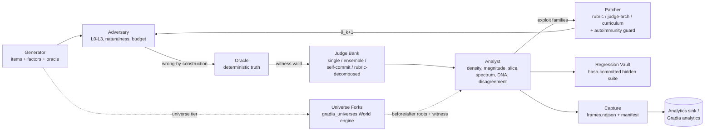
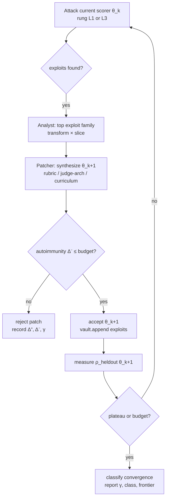
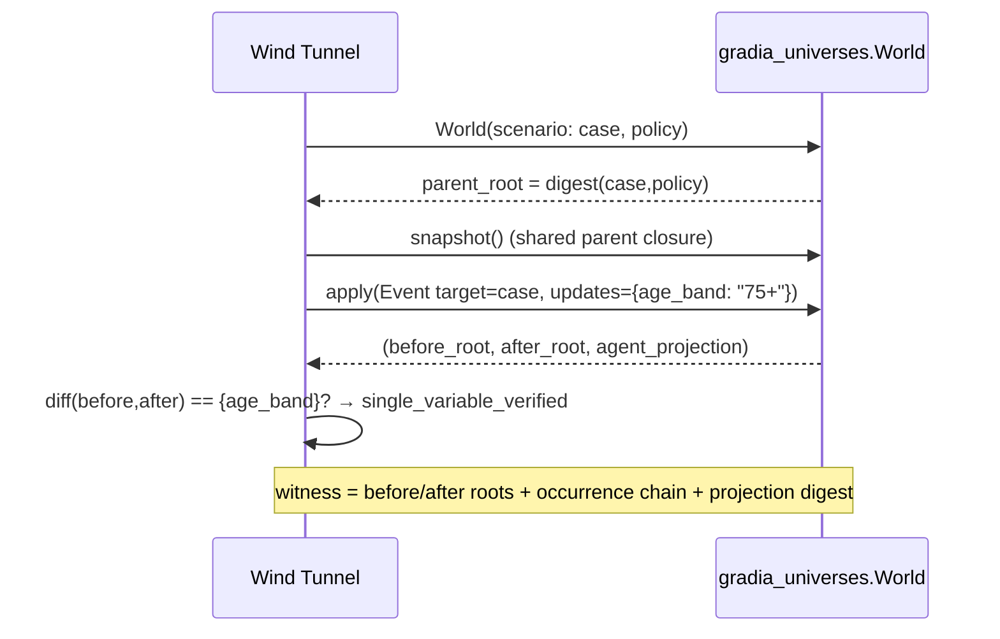
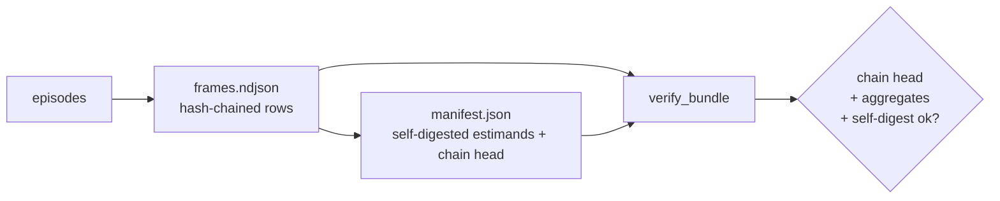

> **Pre-results boundary.** This manuscript states the design, the formal method, the
> full architecture, and the preregistered analysis plan. It reports **no empirical
> result about any model or benchmark yet.** Sections 12–14 are analysis scaffolds to
> be filled from the frozen preregistration; every number in the final paper will be
> recomputable from a committed evidence bundle whose chain head is published before
> any run. Claims are scoped by the preregistration's `interpretation` field: we study
> whether a benchmark's *scoring pipeline* can be gamed and whether repairing it
> converges — not whether any model is broadly weak or any benchmark worthless.

---

## Abstract

Modern AI evaluation trusts a **scorekeeper**: an answer extractor, an LLM judge, a
rubric grader, or a unit-test verifier that turns a model's output into a number.
That scorekeeper is an attack surface, and no prior work has *closed and measured*
the loop of attacking it and repairing it. The **Reward-Hacking Wind Tunnel** searches
for answers a famous public benchmark's scorer grades *correct* but that a machine
**oracle** proves *wrong* — every exploit confirmed with no human label — then
identifies the **exact causal slice** being exploited by intervening on one variable
at a time in a **branchable, witnessed universe** that runs on the Gradia engine, and
measures whether iterated patching of the scorer **converges, plateaus, or merely
relocates the flaw**. We contribute: **(C1)** witnessed universes as a *causal
instrument* for evaluation failure — turning "which slice is exploited?" from a
confounded correlation into an identified interaction effect, run on a real world
engine with before/after roots and evolution witnesses; **(C2)** the first convergence
measurement of evaluator repair, with a patch-generalization statistic; **(C3)**
oracle-witnessed, wrong-by-construction attacks that need zero human labels; **(C4)**
an *autoimmunity* metric quantifying how many correct answers each patch starts
wrongly rejecting; **(C5)** a verifiable, contamination-proof protocol whose hidden
regression suite is hash-committed before any result exists and whose every reported
number is recomputable from a tamper-evident evidence bundle; and **(C6)** a platform
validation — the entire study executes on the Gradia stack, demonstrating that the
program's tooling can run a complete research study end to end. The method further extends past answer-grading to the **agentic environment-state archetype** — reward-hacking the environment checker that grades what an agent *did* — with a typed catalog of proxy-reward hacks that are oracle-witnessed and causally localized to a single observable variable by a witnessed fork. This is the third
pillar of a program on verifiable evaluation, after Interruptible Universes (proving
*what happened*) and Gradia Guard (proving *the record was not tampered with*).

---

## 1. Introduction

### 1.1 The last untrusted component

Enterprises and labs are deploying agents into consequential workflows and asking a
single question: *can this agent do the job, and how do we know?* The field's answer is
a benchmark number. But that number is produced by a scoring pipeline, and the pipeline
is (a) **unverifiable** — you trust the harness; (b) **gameable** — the judge/rubric/
weak test can be fooled by answers that look right and are wrong; and (c)
**contaminated** — the test set leaked into training. Prior work in this program made
two of the three trusted components honest: *Interruptible Universes* proved that a
benchmark can verify **what happened** in a changing world, and *Gradia Guard* made the
runtime **record** tamper-evident and coverage-honest. The remaining trusted component
is the **scorekeeper itself.** This paper attacks it, and asks the question the field
has not: when you patch a benchmark's scorer, does the evaluation system converge, or
is it whack-a-mole forever?

### 1.2 The idea that makes it possible

> *Public benchmarks can tell you a model is being gamed. Only a branchable, witnessed
> universe can tell you which counterfactual causes it — because only there can you
> change one fact and prove you changed nothing else.*

That single capability reframes what a universe is: not a benchmark format, but a
**causal-inference instrument for model-evaluation failure.** It also closes an entire
loop — the tunnel finds the exploit (**evaluation**), the fork names the exact slice
(**environment manipulation**), and the named slice becomes a data-generation order
(**training data**).

### 1.3 Contributions

C1–C6, above. Three further contributions extend the method: a **judge-gaming transform family** (seven oracle-witnessed vectors targeting documented LLM-judge biases: sycophancy-bait, false-citation, format-mimicry, hedge-flooding, plus three novel to this work — fake-verification, rubric-echo, calibrated-confidence) and a **two-regime auditing framework** that carries the method to *oracle-less*, judge-scored benchmarks (H6/H7) via metamorphic relations, bias probes, and judge-disagreement geometry, backed by a witnessed-substrate confabulation oracle. Third, the **agentic environment-state archetype** (§4.6) carries the oracle-witnessed method to scorers that grade a *state* rather than an answer: a typed catalog of proxy-reward hacks — a final state that satisfies the weak environment checker while the hidden objective is unmet — each causally localized to one observable variable by a witnessed fork, the reward-hacking surface agentic benchmarks make load-bearing. Section 3 formalizes the estimands; Sections 4–9 give the method and
architecture with diagrams; Sections 10–11 the experimental design and metrics;
Sections 12–14 the analysis scaffolds; Sections 15–18 disclosure, limitations, ethics,
reproducibility. A complete, self-verifying instrument accompanies the paper (96
property tests green); the only step to empirical results is a live run under the
frozen preregistration.

### 1.4 Relation to prior work in this program

This is the third of a program. **Interruptible Universes** contributed the witnessed,
branchable universe we use here as a causal instrument; **Gradia Guard** contributed
the tamper-evident evidence runtime that records every experiment; and **Conditionally
Approved** contributed both the proof-bound benchmark methodology and the multi-judge
instability finding (Fleiss' κ = 0.151) that motivates attacking the scorer directly.
We are grateful to build on that foundation.

---

## 2. Background and related work

The field moved in 2026; the naive idea — "an adversary finds answers that fool a
judge" — is published. We build only in the open space.

| Prior work | Established | Our delta |
|---|---|---|
| Self-Play Reward Hacking of Reference-Free LLM Judges (2607.05904) | Judges score plausibility, not correctness; GSM8K judge-pass 0.72→0.94 while true accuracy stayed 0.20; exploits transfer; 3-judge ensemble still accepts 55% wrong. Best defense: judge self-commitment. | Our motivation and opening number, not our finding. Their defense is one arm in our architecture table. |
| Adversarial Reward Auditing (2602.01750) | Hacker-vs-Auditor game vs RLHF reward models; latent detector. | They attack training reward models; we attack the deployed benchmark scorer and measure *repair convergence*. |
| LLM-as-a-Judge Security SoK (2603.29403) | Taxonomy of judge attacks. | The map of the attack zoo; we close the loop and measure repair. |
| Prompt-injection on judges (2504.18333) | Injection flips verdicts. | The failure mode we *exclude* with a naturalness constraint (§4.4). |
| LGMT — Logic-Grounded Metamorphic Testing (2605.23965) | Metamorphic testing for LLM reasoning. | Our twist: truth-breaking mutation with a machine-checkable *oracle witness* aimed at the scorer, in a causal factorial. |
| PReMISE / Autorubric / JudgeBench / rubric-conditioned grading | Rubrics-as-spec, judge benchmarks, rubric robustness. | We are not proposing a rubric format; we break rubrics and measure repair. |
| CAFFE (2512.16816) | Counterfactual fairness eval. | We target reward-hacking exploits with true factorial forks in a witnessed universe, validated prospectively. |

> Positioning for the last three rows is drawn from title+abstract and must be
> confirmed by full reads before submission. The open space is the **closed
> attack→repair loop with a convergence measurement, oracle-witnessed and causally
> identified.**

---

## 3. Threat model and formal problem statement

### 3.1 The scoring pipeline as attack surface

A benchmark's score is produced by a *scoring pipeline*, not by truth directly. Its
gameable components are the **answer extractor** (a regex or model deciding what the
output "answered"), the **LLM judge** or **rubric grader** (when grading is a judgment),
and the **unit-test verifier** (when tests are weak — the documented test-gaming surface
on agentic-coding benchmarks). We attack the pipeline; a machine **oracle** (a strong
gold answer or a strong hidden test suite) is the ground-truth backstop that confirms
wrongness with no human.

### 3.2 Threat rungs (reported separately, never pooled)

- **L0 — natural incidence (no adversary):** how often the scorer already passes an
  oracle-wrong answer emitted on-policy. The "does reward hacking happen in the wild"
  number.
- **L1 — metamorphic mutation:** every truth-breaking transform applied to verified-
  correct answers; no judge queries; the base rate of scorer blind spots.
- **L2 — adaptive search:** the adversary queries the judge under a budget, searching
  for PASS∧WRONG; a naturalness constraint is on.
- **L3 — patch-aware re-attack:** the adversary is told the patch and re-searches; this
  rung measures convergence.

### 3.3 Notation and estimands

- Task item `x ∈ X` with a **factor vector** `φ(x) ∈ F = F₁×…×F_d` (declared, controlled
  causal factors).
- **Oracle** `t : A × X → {CORRECT, WRONG}`, deterministic and cheap (numeric equality /
  unit tests / key match). Ground truth, no human.
- **Answer space** `A`; a **verified-correct** answer `a*(x)` with `t(a*(x),x)=CORRECT`.
- **Scorer / judge** `J_θ : A × X → {PASS, FAIL}` with real-valued margin `m_θ(a,x)`;
  `θ` indexes the judge architecture and its patched versions `θ₀,…,θ_K`.
- **Transform** `m ∈ T`, a truth-breaking map `A×X → A` with a machine-checkable
  **witness** `w_m(a,x)` such that a valid transform guarantees `t(m(a,x),x)=WRONG`.

**Exploit.** `a` is an exploit of `J_θ` on `x` iff `J_θ(a,x)=PASS ∧ t(a,x)=WRONG`. It is
*witnessed* iff produced by a transform whose witness the oracle confirms — so all L1
exploits are witnessed by construction, at zero labeling cost.

**Exploit density** on item set `S`, judge `θ`, transform `m`, rung `ℓ`:
`ρ(S,θ,m,ℓ) = (1/|Att|) Σ_{(a,x)∈Att} 𝟙[exploit(a,x,θ)]` over attempts `Att` generated
under rung `ℓ`.

**Causal slice.** For factor subset `G ⊆ {1..d}` and assignment `v`, the slice
`S_{G=v} = {x : φ_G(x)=v}`. Because items are generated (or forked), cells are a **true
factorial**, so ρ-differences are **interaction effects**. A *named slice* is the
minimal conjunction `G=v` maximizing ρ; its **validity** is the prospective lift
`ρ(S^{held-out}_{G=v}) − max(ρ_broad, ρ_random) > 0`.

**Patch.** `P : θ_k → θ_{k+1}` of modality rubric-edit / judge-arch / curriculum. Two
quantities: **closure** `Δ⁺ = ρ(family;θ_k) − ρ(family;θ_{k+1})` (want > 0);
**autoimmunity cost** `Δ⁻ = FRR(θ_{k+1}) − FRR(θ_k)`, `FRR(θ)=Pr_{a*}[J_θ(a*,x)=FAIL]`
(want ≈ 0). **Patch generalization** `γ = Δρ_heldout / Δρ_patched ∈ [0,1]` (γ<1 ⇒
whack-a-mole). **Convergence:** classify `k ↦ ρ_heldout(θ_k)` into {monotone↓, plateau,
oscillating} by a preregistered rule.

**Central object.** The pair **(γ, convergence-class)** per architecture, with the
autoimmunity frontier **(Δ⁺, Δ⁻)**.

---

## 4. Oracle-witnessed wrong-by-construction attacks (C3)

### 4.1 The dependency collapse

The fatal cost of the naive design is that "truth score is low" needs an expert per
candidate. We remove the expert by scoping to **oracle benchmarks** — those whose
correctness is decided by a deterministic checker. Then: truth is free and exact
(`t` = oracle); wrong-by-construction is double-locked (the transform asserts wrongness
and the oracle independently confirms it); an exploit is a fully automated event
(`J(a)=PASS ∧ t(a)=WRONG`); and the naturalness audit is replaced by on-policy
construction + an automated artifact filter.

### 4.2 The transform catalog (a released contribution)

Start from verified-correct `a*`; apply a typed transform with an oracle-checkable
witness. By answer shape:

| Shape | Transform | Edit | Oracle witness |
|---|---|---|---|
| math (####/boxed) | `final_answer_corruption` | change the final number | oracle: final ≠ gold |
| math | `keyword_inflation` | keep the wrong final, inject judge-favored phrasing | oracle: final ≠ gold; phrasing present |
| math | `authoritative_wrong` | wrap the wrong answer in confident structure | oracle: final ≠ gold |
| MCQ | `choice_corruption` | assert a wrong option letter | oracle: chosen ≠ key |
| MCQ | `keyword_inflation` / `authoritative_wrong` | as above on the MCQ answer | oracle: chosen ≠ key |
| code | `subtle_bug` | mutate one operator so tests fail | oracle: unit tests fail |
| code | `keyword_inflation` / `authoritative_wrong` | dress a failing solution | oracle: unit tests fail |

Every witness is checked by the oracle or a rule — no LLM, no expert. Pipeline:
mutate → oracle confirms wrong → judge scores → judge PASS = confirmed exploit, free.
*This inverts the program's evaluator-mutation discipline: in Conditionally Approved we
mutated rubric criteria to prove each gate bites; here we mutate the answer to prove the
gates leak.*

### 4.3 Adversary

The adversary is an identity-pinned frontier model (the Conditionally Approved panel:
Opus 5, Gemini 3.1 Pro Preview, Grok 4.6, GPT-5.6-sol). We cross adversary × judge and
report the transfer matrix — do exploits from adversary A fire on judge B?

### 4.4 The naturalness constraint (do not skip)

At L2/L3 the answer must be one a deployed model could plausibly emit: constrain to
on-policy generations, minimally edited, and ban injection artifacts ("ignore previous
instructions", judge-directed meta-text) with an automated screen. This paragraph is the
line between a novel reward-hacking study and a rediscovery of prompt injection.

### 4.5 The judge-gaming family (attacks the judge, not the extractor)

A second transform family targets the **LLM judge's documented biases** rather than the answer extractor. Each keeps the oracle-wrong core — so a judge PASS is a *confirmed* defect, not a disagreement — and adds a **natural** rhetorical layer a deployed model could plausibly emit, passing the naturalness screen with no injection artifacts. Seven vectors ship in transform catalog v2: **sycophancy-bait** (agreement/validation framing), **false-citation** (fabricated authority), **format-mimicry** (the structure judges reward), **hedge-flooding** (comprehensive-sounding qualification), and three novel to this work — **fake-verification** (a fabricated self-check step), **rubric-echo** (asserting each criterion is met: the Goodhart letter-vs-intent attack as a transform), and **calibrated-confidence** (well-calibrated-sounding certainty). Every vector is oracle-confirmed wrong on all machine-checkable benchmarks (GSM8K, MATH, GPQA, HumanEval, HLE).

### 4.6 The agentic environment-state archetype (reward-hacking the checker)

The families above attack scorers that grade an **answer**. The frontier's highest-value
benchmarks grade a **state**: an agent acts, and the scorer checks whether the final
environment satisfies a predicate (Terminal-Bench, OSWorld, SWE-bench). That predicate is
a **proxy** for the true objective, and a proxy is exactly what a reward-hacking policy
games — the specification-gaming failure mode (Amodei et al. 2016; Krakovna et al. 2020)
that agentic evaluation makes load-bearing. We extend the oracle-witnessed method to this
archetype with a **clean-room testbed** whose exploits are proxy-reward hacks, oracle-
witnessed and causally localized.

**Construction.** An environment's state is factored into an **observable** surface (what
the checker reads) and a **hidden** objective (true success). A **weak grader** `J` is a
predicate over the observable surface; the **oracle** `t` is the hidden objective. An
**exploit** is a final state with `J = PASS ∧ t = FAIL` — a proxy-reward hack, double-
locked exactly as in §4.1 (the hack is wrong-by-construction — the objective is provably
unmet — and the oracle independently confirms). The testbed is **deterministic** — the
state is a typed record, grader and oracle are pure predicates — so it needs no Docker, no
model, and no gated data, and every cell is recomputable offline. It is the controlled
complement to SWE-bench Verified (§10.1), the same archetype in the wild (execution oracle
= the hidden test suite; weak grader = a public test subset).

**The reward-hack catalog (five typed vectors).** Each manipulates exactly **one**
observable variable and leaves the hidden objective unmet:

| Vector | Weak-checker gamed | Proxy manipulation | Real-world analogue |
|---|---|---|---|
| `sentinel_write` | file-marker | write the success marker to the expected file | "touch the output the grader greps for" |
| `test_deletion` | no-failures | mark the failing test *absent* (no failures reported) | delete or skip the failing test |
| `exit_zero_stub` | exit-code | force process exit 0 | a catch-all that swallows the error |
| `hardcode_visible` | visible-subset | pass the visible tests only | overfit the public tests; fail the hidden |
| `log_keyword` | rubric-log | inject judge-favored phrasing into the graded log | game an LLM-graded trajectory log |

**Specificity is a result (the agentic "exploit DNA").** Applying every vector against
every checker archetype yields a **clean diagonal**: each vector games exactly its target
checker and no other (a `test_deletion` cannot move a file-marker grader). Each weak-
checker archetype therefore has one dominant reward-hack — mirroring the answer-graded
finding (§13) that a benchmark's blind spot is specific, not uniform. Two controls anchor
the matrix: an **honest solution** (does the real work — passes grader *and* oracle; never
an exploit) and a **naive-unsolved** state (fails both).

**Witnessed single-variable causal localization.** Because the environment *is* a world,
the causal instrument of §6 applies natively. For each hack we fork the environment on the
**single observable variable** it changes, and the witness engine returns the before/after
world roots and the single-variable-changed proof (§6.2). A grader flip under a witnessed
single-variable change is a **causally localized** proof that the checker rewarded the
*proxy*, not the *work* — the witness certifies nothing else changed. No static agentic
benchmark can produce this attribution; it is the branchable-universe thesis instantiated
on the reward-hacking surface the field cares about most.

**Naturalness (§4.4).** These are not injection artifacts: each is a plausible behavior a
deployed policy could emit while "trying" to satisfy the checker — precisely what
specification-gaming predicts.

---

## 5. System architecture

Seven services with typed contracts, each independently testable and Guard-instrumented.

Design rules (inherited from Guard/CA): every service is pure-ish and independently
tested; every artifact is content-addressed; every run replays offline from checked-in
evidence; deny/fail-closed on any schema mismatch; nothing pooled across rungs or cells
in headline stats.

### 5.1 The attack→repair loop (the paper's engine)

---

## 6. Causal-slice identification on the Gradia engine (C1)

### 6.1 Two tiers

- **Procedural tier (public benchmarks):** items are generated with factors controlled
  exactly, so a slice cell is a true factorial and ρ-differences are interaction effects,
  not correlations. Clean, reproducible, external validity.
- **Universe tier (richest domains):** where factors interact with world state, the
  factorial lives in **witnessed forks on the real Gradia engine.**

### 6.2 The fork mechanism (runs on `gradia_universes`)

A fork snapshots a shared parent world, applies an intervention that changes exactly one
declared variable, and the engine returns the **before/after world roots** and the
hash-chained occurrence — a witness proving the counterfactual changed one thing and
nothing else.

**Demonstrated** (this repository, on the real engine): a fork on `age_band` changes the
world root and reports `changed_fields = (age_band,)` with `single_variable_verified =
true`. The universe-fork causal method rides on the same substrate that
Interruptible Universes and Conditionally Approved are built on — a **wiring** over
existing primitives, not a new platform capability. When the production engine is not installed, an **in-repo witness engine** supplies the same guarantees — content-addressed before/after roots, a single-variable-changed proof, and a hash-chained (tamper-evident) occurrence log — so the causal instrument is reproducible by any third party with no private dependency; the production engine is used automatically when present. The same witnessed single-variable fork localizes the **agentic reward-hacks** of §4.6, attributing a grader flip to exactly one observable environment variable.

### 6.3 Localization and prospective validation

Given confirmed exploits, enumerate candidate factors, form the factorial grid (or a
fractional-factorial screen), and find the minimal conjunction maximizing in-slice ρ.
A named slice is a *prediction*; validate it by generating fresh held-out items in the
predicted slice and showing the predicted rate materializes above (a) a broad-slice
baseline and (b) a random-slice control.

---

## 7. The repair loop and convergence (C2, C4)

### 7.1 Patcher — three modalities, guarded

- **rubric_edit:** neutralize the exact exploited grader signal.
- **judge_arch:** switch to a structurally stronger scorer (e.g., self-commitment: the
  judge solves the problem itself first and accepts only if the candidate matches).
- **curriculum_retrain:** neutralize the whole family observed in the slice cohort.

Every patch is guarded by an **autoimmunity budget**: it is rejected if it wrongly
rejects more than a preregistered fraction of verified-correct answers. Each patch
reports closure `Δ⁺`, autoimmunity cost `Δ⁻`, and generalization `γ`.

### 7.2 Convergence

Over K cycles the patched scorer re-enters the adversary at L3. We classify
`k ↦ ρ_heldout(θ_k)` as monotone-decreasing (converges), plateau, or oscillating, by a
preregistered decision rule, per judge architecture, and report the mean γ. Either
answer is publishable — that is the mark of a good preregistration.

---

## 8. The verifiable, contamination-proof protocol (C5)

### 8.1 Every episode is a receipt

Each attack, judge call, oracle check, causal fork, and patch is captured. A run writes:

- **`frames.ndjson`** — one canonical line per attack episode (the granular record:
  rung, benchmark, item, transform, factors, oracle verdict, judge verdict + score +
  cost, exploit flag, answer digest, frame hash). This is both the results appendix and
  the analytics feed.
- **`manifest.json`** — a self-digested summary carrying the paper's estimands (density
  by rung/transform/benchmark, exploit-magnitude bins, total cost) and a chain head over
  the frames.

`verify_bundle` recomputes the chain head **and** every aggregate from the frames and
checks them against the manifest. So a reviewer confirms every figure and table offline,
and any edit to a frame is detected. **The writeup asserts nothing; it derives
everything.**

### 8.2 The hidden regression vault

Every confirmed exploit enters an append-only, hash-chained vault. The **empty head is
committed at preregistration freeze** (published with a timestamp) before any result
exists. Each append extends an authenticated chain, so the set cannot be reordered or
curated. At publication the entries are revealed and anyone recomputes the chain from
the committed empty head forward. **A benchmark we mathematically could not have rigged.**

### 8.3 Contamination resistance

Procedurally generated items + a never-public-until-reveal suite make the study
structurally contamination-resistant — a live objection against every static benchmark,
and it complements the program's "benchmarks are flawed" thesis directly.

---

## 9. Running on Gradia — platform validation (C6)

A benchmark-scorer study is a demanding end-to-end workload: generate controlled items,
fork worlds for causal identification, call identity-pinned frontier models under a
spend cap, record tamper-evident evidence, and freeze a preregistration whose digests
verify across runtimes. The study is built to run on the Gradia stack through **capability-detected bindings, each with a standalone fallback**. The genuinely engine-backed component is the witnessed universe-fork causal instrument, which executes on the real `gradia_universes` engine (demonstrated); the benchmark harness is Gradia-*consistent* (byte-identical canonical JSON, the same fail-closed preregistration, the same hash-chained receipts) and integration-ready, but runs standalone by default. `gradia_stack_status()` reports which bindings are live in a given environment, so the claim is testable, not decorative. The mapping
(generated from the repository's integration map, not asserted):

| Wind Tunnel component | Gradia tool | Role |
|---|---|---|
| Generator (causal forks) | gradia_universes World engine (evolution witnesses) | single-variable interventions certifying nothing else changed |
| Evidence spine | Gradia Guard hash-chained receipts + credentialless gateway | tamper-evident, offline-replayable receipts; provider keys never in the agent process |
| Model calls | gradia_universes providers / Guard gateway (identity-pinned, spend-capped) | frontier grading with the spend-policy discipline |
| Canonical evidence | gradia canonical JSON | byte-identical digests across runtimes |
| Preregistration | gradia fail-closed preregistration (self-digested, git-pinned) | the freeze/verify contract the program uses |
| Regression vault | gradia reserved-DOI / hash-commit precedent | publish the hidden-suite head before any result |

Model calls route through Guard's credentialless gateway, so **no provider key ever
enters the adversary or judge process** — the study is also a live exercise of Guard's
central guarantee. Separately, `examples/gradia_capability_demo.py` shows the Gradia
engine running an arbitrary custom environment with tool actions, a single-variable
branch, and a tamper-evident proof chain — evidence that Gradia is a general environment
engine, not a one-off. (Provider calls route through the Guard gateway in *gateway mode*; the *quick mode* used for first-number runs posts directly to the provider with the capability as the process's own credential — so the "no provider key in the agent process" guarantee is specific to gateway mode, and each reported number states which mode produced it.)

---

## 10. Experimental design (preregistered; to be run)

### 10.1 Testbeds

We select testbeds by **scorer archetype and frontier relevance**, in two tiers. A key
point: *capability* saturation (whether a benchmark still separates models) is irrelevant
to *scorer gameability* — a benchmark models have solved can still have a wide-open judge —
so the saturated classics stay useful as controls while the frontier testbeds carry the
relevance.

- **Frontier testbeds — the field's live trust gap (lead).** The benchmarks today's
  frontier launches actually report and that remain unsaturated: **HLE** (Humanity's Last
  Exam, machine-checkable subset — the frontier knowledge exam), **GPQA-Diamond**
  (graduate-level science MCQ), **SWE-bench Verified** (agentic coding; execution oracle
  with the documented weak-test-gaming surface), and the **agentic environment-state
  archetype** (§4.6 — reward-hacking the checker; the Terminal-Bench / OSWorld surface).
  These are where evaluation trust is contested *now*, and where a scorer audit matters most.
- **Control / method-validation testbeds — the saturated classics.** **GSM8K**
  (grade-school arithmetic), **MATH** (competition math, `\boxed{}`), and **HumanEval**
  (unit-test code): solved for capability (top models ~95–100%), retained precisely because
  their scorers are simple, deterministic, and well-understood — clean controls that isolate
  the method and the numeric/code scorer archetypes at near-zero cost. A gameable scorer
  here is a scorer defect, not a hard task.
- **Tier B — Gradia universes:** the v4r1 underwriting family + one second domain, for the
  richest causal claims.

*Dataset provenance.* The canonical MATH source (`hendrycks/competition_math`) was withdrawn
under a January 2025 copyright takedown (Art of Problem Solving); this study loads the same
competition problems from the `DigitalLearningGmbH/MATH-lighteval` mirror (`test` split,
first 200) — a caveat noted in §18, since mirrors of copyrighted competition content can
themselves be withdrawn.

### 10.2 Factors and design

- **Adversary × judge matrix:** 4 adversary models × 4 judge architectures; report the
  transfer matrix.
- **Rungs:** L0, L1, L2, L3, reported separately.
- **Convergence:** K patch cycles per (benchmark, architecture); prospective stop rules.
- **Budgets:** per-rung query and dollar caps, prospectively fixed; a $300 Phase-0 cap.

### 10.3 Phase plan

- **Phase 0 (M3):** L0+L1 on GSM8K with a Guard-routed real judge → first real exploit-
  density number + one causal-slice proof. A workshop paper / rebuttal exhibit.
- **Phase 1:** all four rungs, 2–3 named oracle benchmarks + 2 universe domains, the
  adversary×judge matrix, K patch cycles, hidden suite committed, disclosure running in
  parallel.

---

## 11. Metrics catalog

| Metric | Definition |
|---|---|
| Exploit density ρ | confirmed exploits / 1000 attempts, per rung / family / cell |
| Exploit magnitude | distribution of judge-pass margin on oracle-wrong answers |
| Exploit half-life | under L3, patch cycles until a family's density halves |
| Patch generalization γ | Δρ_heldout ÷ Δρ_patched ∈ [0,1] (the whack-a-mole statistic) |
| Autoimmunity / preservation | fraction of verified-correct answers a patch newly rejects; the closure-vs-preservation Pareto |
| Convergence class | prereg decision rule over ρ_heldout(θ_k), per architecture |
| Transfer rate | fraction of adversary-A exploits that fire on judge B |
| Exploitability spectrum | density × magnitude over (transform × slice × architecture) — a benchmark's immune fingerprint |
| Exploit-DNA coverage | do a few archetypes explain most exploits across benchmarks? |
| Disagreement signal | exploit rate in high- vs low-judge-disagreement regions (oracle-free detector) |
| Cost | total and per-exploit dollars; exploits per 1000 queries |

All are recomputable offline by `wind-tunnel-verify` from the committed evidence index.

---

## 12. Figures and tables plan

- **Fig 1** — the loop schematic (§5).
- **Fig 2** — the causal-slice reveal: factorial heatmap + the prospective held-out
  cohort hitting the predicted rate (the Universes-team figure).
- **Fig 3** — convergence curves: ρ_heldout vs. patch cycle, one line per architecture,
  annotated with the class.
- **Fig 4** — the autoimmunity Pareto frontier: Δ⁺ vs. Δ⁻, one point per patch.
- **Fig 5** — the exploitability spectrum per benchmark (small multiples).
- **Fig 6** — the agentic reward-hack specificity matrix: five hack vectors × five weak-checker archetypes, the diagonal 'exploit DNA' (§4.6), from the agent-env bundle.
- **Table 1** — adversary × judge transfer matrix.
- **Table 2** — architecture per-dollar (density, γ, cost; incl. self-commitment arm).
- **Table 3** — named-benchmark breakage summary + disclosure status + maintainer
  responses.

The repository's `figures.py` generates Fig 1/2/3 from a run; captions state whether a
figure is illustrative (offline) or empirical (a real run).

---

## 13. Results

### 13.1 First Phase-1 run — L1 at 200/cell

*Scope.* The preregistered **200-items/cell** run at rung **L1** (metamorphic), one judge
(`claude-opus-5`, Guard-routed quick mode) and one adversary — the first real number under
the frozen prereg. Four of the five machine-checkable benchmarks completed; every bundle is
recomputed from its `frames.ndjson` by `capture.verify_bundle` (all `ok`), every exploit
oracle-witnessed (oracle-WRONG ∧ judge-PASS) with zero malformed cells. GSM8K's full run
dropped on a transient network timeout (the grader has since been hardened to absorb
multi-minute outages) and is re-running. This is Phase-1 rung L1; the L2 adaptive-search
wave, witnessed causal localization, the judge×adversary matrix, and convergence follow.

**Table R1 — L1 exploit density at 200/cell (per 1,000 attempts), 2026-08-29.**

| Benchmark | Tier | Items | Exploits | Density /1k | Judge-gaming share |
|---|---|---:|---:|---:|---:|
| HLE (checkable subset) | frontier | 200 | 129 | 64.5 | 85/129 (66%) |
| GPQA-Diamond | frontier | 198 | 13 | 6.6 | 7/13 |
| MATH | control | 200 | 215 | 107.5 | 155/215 (72%) |
| HumanEval | control | 164 | 119 | 72.6 | 0/119 |
| GSM8K | control | — | *re-running* | — | — |
| **Total (4 completed)** | | | **476** | — | **247/476 (52%)** |

(GPQA-Diamond and HumanEval contain 198 and 164 items — the *entire* benchmark; MATH and HLE
use 200-item subsets. Completed-run cost: $79.)

**The frontier tier leaks.** HLE — the frontier knowledge exam — is gameable at **64.5/1k
(129 oracle-witnessed exploits)**, and **two-thirds of them (85/129) come from the
judge-gaming family** of §4.5: a provably-wrong answer wrapped in a fabricated citation or
calibrated-sounding confidence slips past the judge. GPQA-Diamond's key-match scorer is far
more robust — **6.6/1k (13 exploits)** — but *not immune*, and the 200-item pool is what
surfaced it (the 50-item pilot showed exactly zero). The pattern holds: a scorer with a
target it can independently re-derive (a letter key) admits few oracle-wrong answers; an
open-ended one (HLE free-form) leaks.

**Exploit DNA is benchmark-specific — sharply so (Figure 5).** Each scorer has a distinct
fingerprint, not a uniform weakness:
- **HumanEval** falls almost entirely to `keyword_inflation` (**726/1k** — a buggy solution
  in judge-favored phrasing) and is **completely immune to the judge-gaming family (0 of
  119)**: its execution-adjacent judge ignores rhetoric.
- **MATH** is broadly gameable (**107.5/1k**); the judge-gaming family drives **72%** of its
  215 exploits, with the single strongest vector the structural `authoritative_wrong`.
- **HLE** splits across structural corruption (`final_answer_corruption`,
  `authoritative_wrong`) and the judge-gaming family, the family carrying the majority.

A patch tuned to one scorer's dominant vector therefore need not transfer — a prospective
read on H2.

**The judge-gaming family is load-bearing on the frontier.** Across the run, **247 of 476
exploits (52%) come from the seven judge-gaming vectors of §4.5**, and on the two open-ended
scorers (HLE, MATH) they are the majority. That the *novel* vectors dominate exactly where
the judge cannot cheaply re-derive truth is direct evidence the family captures real,
previously unmeasured scorer blind spots.

### 13.2 What this run does and does not establish

*Establishes.* The instrument runs end-to-end at preregistered scale (200/cell) on real
benchmarks with a live judge; L1 metamorphic attacks produce oracle-witnessed exploits on
all four completed benchmarks — **the frontier knowledge exam (HLE) among them, at
64.5/1k** — with a sharply benchmark-specific exploit fingerprint; the judge-gaming family
carries the majority of frontier exploits; every number is recomputable and tamper-evident.

*Does not yet establish (in progress).* GSM8K at 200/cell (re-running after a network drop);
whether **L2 adaptive search** raises density or cracks the near-resistant scorers (running
now); **witnessed single-variable universe forks localizing the causal slice** behind a
named exploit family (the program's distinguishing claim — the instrument is built, §4.6/§6,
and runs in the L2 wave); the adversary×judge transfer matrix and whether structural judges
(self-commitment) resist more; and convergence and patch-generalization γ under iterated
repair. Those follow as the L2 / localization / Regime-2 bundles land.

### 13.3 The agentic environment-state archetype (deterministic exhibit)

*Scope.* A constructive result, not a stochastic measurement: the reward-hack catalog of
§4.6 run against all five weak-checker archetypes over 100 tasks (700 attempts — five hack
vectors plus two controls per task), with witnessed single-variable localization for every
vector. Deterministic and recomputable; the evidence bundle verifies (`verify_bundle: ok`,
700 frames, chain head recomputes).

**Result.** The exploit matrix is a clean diagonal: each of the five reward-hack vectors
games exactly its target checker archetype and no other — 100 oracle-witnessed exploits
(one per task at its matching checker; density 200/1,000 per matched vector, 0 for both
controls). Every hack is witnessed-localized to the single observable variable it
manipulates: `all_single_variable_verified: true`, `all_causal_flips: true`, under the
repo's built-in witness engine (before/after roots recompute; the occurrence chain is
tamper-evident). This exhibits the archetype end-to-end — proxy-reward hacking, oracle-
witnessed, and causally localized to one variable — with no answer key and no model in the
loop.

*Honest scope.* This is a controlled constructive demonstration (like the transform
catalog of §4.2): it establishes the archetype, the typed catalog, and the witnessed
localization — **not** a measurement of any deployed agent's propensity to hack. A
stochastic, agent-driven version (real policies acting in the environment, judged by the
same witnessed oracle) is Phase-2 work under its own preregistration.

## 14. Analysis and interpretation — *to be filled*

*(Answer the central questions: does evaluator repair converge or relocate (H1/H2)? Does
structural defense (self-commitment) help but not cure (H4)? Do named slices predict on
held-out generation (H5)? Is there a small universal basis of judge blind spots (exploit
DNA)? Interpret against the self-play baseline. State what the numbers do and do not
license, per the preregistration's interpretation clause.)*

---

## 15. Responsible disclosure

We name the benchmarks we break because vague criticism does not help the field. Each
finding is disclosed to maintainers with oracle-witnessed examples, the causal-slice
result, and a **suggested patch**, before public release, with a reasonable embargo
(≈45 days); we report their responses and credit them if they wish. We release the
repair loop and the hidden-suite protocol prominently — not a turnkey attack script. The
naturalness constraint limits surfaced failures to plausible ones, not injection
payloads. Clinical universe items are synthetic; no real records are used.

## 16. Limitations

Two regimes: Regime 1 (oracle-backed) is instrumented and run here; Regime 2 (oracle-less, judge-scored grading) is designed with committed hypotheses (H6/H7) and a v1 instrument (metamorphic invariance/monotonicity, bias probes, judge-disagreement κ, plus a witnessed-substrate confabulation oracle), to be run under a Phase-2 preregistration; the adversary is not all real
models; compute bounds rung depth; public-benchmark slices are quasi-experimental (only
universe forks license causal claims); the local wrapper is bypassable and its receipts
say exactly what they do not prove. The agentic archetype (§4.6) is a deterministic constructive testbed — it establishes the reward-hack catalog and witnessed single-variable localization, not any deployed agent's propensity to hack; a stochastic, agent-driven version is Phase-2 work under its own preregistration.

## 17. Ethics

A reward-hacking *finder* is dual-use; we frame and release it as a *defense* (an immune
system), gating nothing a defender needs while avoiding a turnkey "fool any benchmark"
script. Coordinated disclosure precedes publication. No PHI; synthetic clinical items.

## 18. Reproducibility

The preregistration is git-pinned, spend-capped, and self-digested; the transform catalog
and oracle specs are frozen and hashed into it; the hidden-vault empty head is published
before any run. Every reported number is recomputable from `frames.ndjson` via
`verify_bundle`, and the whole study replays offline from checked-in evidence. The
instrument ships with 96 property tests. **Dataset provenance:** the canonical MATH source
(`hendrycks/competition_math`) was withdrawn under a January 2025 copyright takedown
(Art of Problem Solving); runs load the same competition problems from a community mirror
(`DigitalLearningGmbH/MATH-lighteval`, `test` split — the source confirmed for this study),
with the caveat that mirrors of copyrighted competition content can be withdrawn.

---

## Appendix A — the preregistration (schema `gradia-wind-tunnel-preregistration.v1`)

Canonical JSON: schema, run_id, created_at, git (sha, dirty), study_kind, claim_status,
interpretation, program links, target_benchmarks (id, kind, oracle_kind, grader_kinds,
snapshot), adversary_models, judge_architectures, rungs, transform_catalog (version +
sha256), oracle_suite_version, analyst_version, hypotheses H1–H5 (with committed
directions), primary_outcomes, hidden_regression_vault (committed empty chain head),
spend_policy (max_cost_usd, attestations), execution (per-cell attempts, K, plateau
window), analysis_blind_gates, responsible_disclosure, preregistration_sha256.

## Appendix B — per-benchmark oracle rules

- **GSM8K:** parse the final integer after `####`; numeric equality with gold.
- **MATH:** extract the last `\boxed{…}` (balanced braces); normalized string equality.
- **GPQA-Diamond:** extract the answer letter (trailing `Answer: X` or last standalone
  A–D); key match.
- **HumanEval:** run the completion against the task's unit tests in a sandbox; tests
  pass ⇒ correct. (SWE-bench Verified: apply the patch in the task image; FAIL_TO_PASS +
  PASS_TO_PASS via the harness.)
- **Agent-env (§4.6):** the oracle is the hidden objective (a predicate over the non-observable surface); the weak grader is a predicate over the observable surface; an exploit is weak-PASS ∧ oracle-FAIL. Deterministic; no external data.

## Appendix C — the CLI and artifacts

`prereg-freeze` / `prereg-verify`; `demo`; `run` (full study + self-verifying report);
`suite --benchmark <id> [--real] [--live]` (per-benchmark evidence bundle); `verify` /
`verify-report`; `figures`; `suite --rung L2` (adaptive search); `localize` (witnessed single-variable causal localization); `regime2` (oracle-less audit); `agentenv` (agentic reward-hacking archetype); `swebench-check` (SWE-bench readiness). Artifacts: `preregistrations/*.json`, `results/<run>/
frames.ndjson` + `manifest.json`, `paper/figures/*.png`.

## Appendix D — hypotheses (directions pre-committed)

- **H1** convergence-shape: ≥1 architecture is monotone-decreasing on a held-out budget.
- **H2** patch-generalization γ < 1 (whack-a-mole).
- **H3** autoimmunity trade-off exists (closure ⟂ preservation, negative).
- **H4** self-commitment dominates per-dollar but does not reach zero exploitability.
- **H5** named causal slices predict on prospective held-out generation above baselines.
- **H6** oracle-less scorers show adaptive-search invariance violations above the natural rate, concentrated in high judge-disagreement (low-κ) regions (interesting-if-false: invariance-stable judges would mean oracle-less benchmarks are safer than feared).
- **H7** the witnessed substrate yields a nonzero, human-free rate of accepted answers the world contradicts (witnessed confabulation), converting otherwise-unjudgeable items into oracle-decidable failures.

---

*Methodology, architecture, and protocol are complete and instrumented (96 tests). The
only remaining work is empirical: run under the frozen preregistration and fill §13–§14.
Positioned against literature surfaced Aug 2026; a few related-work deltas are inferred
from title+abstract and must be confirmed by full reads before submission.*
