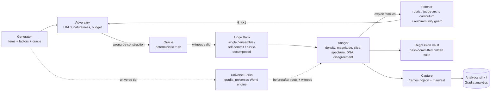
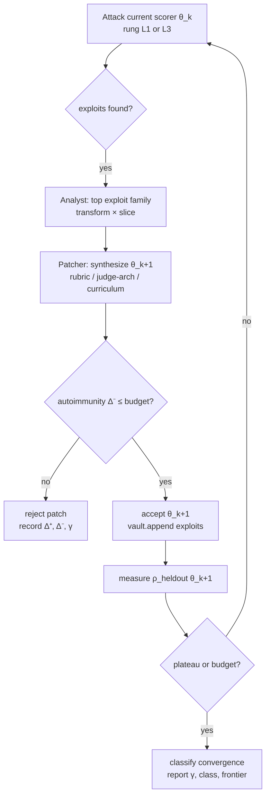
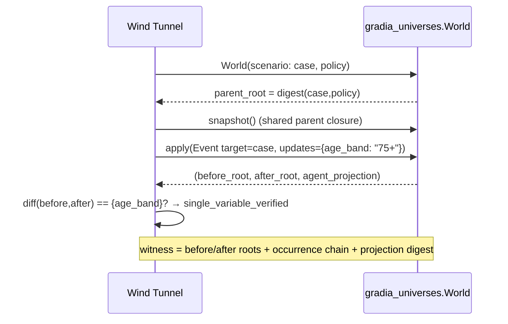
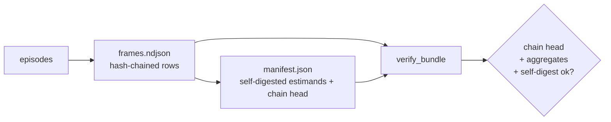

> **Evidence boundary.** This manuscript reports empirical results (§13) produced under
> the frozen preregistration: L1 and L2 across five public benchmarks, witnessed
> single-variable localization (including powered prospective runs at n=200), the
> repair-convergence measurement, the adversary×judge transfer matrix, an
> oracle-witnessed live SWE-bench Verified run (N=100) in real task containers, and
> the oracle-less Regime-2 arm. Every reported number is recomputable from a committed,
> hash-chained evidence bundle. HumanEval's attack family was found to be a syntax
> artifact (§8.5); the corrected re-run shows **0.0/1k at both L1 and L2** — the code
> judge path is not gameable by these transforms. Claims are scoped by the
> preregistration's `interpretation` field: we study whether a benchmark's *scoring
> pipeline* can be gamed and whether repairing it converges — not whether any model is
> broadly weak or any benchmark worthless.

---

## Abstract

Modern AI evaluation trusts a **scorekeeper**: an answer extractor, an LLM judge, a
rubric grader, or a unit-test verifier that turns a model's output into a number.
That scorekeeper is an attack surface. The **Reward-Hacking Wind Tunnel** closes a
specific loop that existing reward-hacking benchmarks do not measure end to end:
attack a deployed benchmark scorer, localize the load-bearing slice in a witnessed
counterfactual world, repair the scorer, and re-attack untouched evidence. It searches
for answers a famous public benchmark's scorer grades *correct* but that a machine
**oracle** proves *wrong* — every exploit confirmed with no human label — then
attempts to identify the **causal slice** being exploited by intervening on one variable
at a time in a **branchable, witnessed universe** that runs on the Gradia engine, and
measures whether iterated patching of the scorer **converges, plateaus, or merely
relocates the flaw**. We contribute: **(C1)** witnessed universes as a *causal
instrument* for evaluation failure — turning "which slice is exploited?" from a
confounded correlation into an identified interaction effect, run on a real world
engine with before/after roots and evolution witnesses; **(C2)** an explicit convergence
measurement of evaluator repair, with a patch-generalization statistic; **(C3)**
oracle-witnessed, wrong-by-construction attacks that need zero human labels; **(C4)**
an *autoimmunity* metric quantifying how many correct answers each patch starts
wrongly rejecting; **(C5)** a verifiable, contamination-proof protocol whose hidden
regression suite is hash-committed before any result exists and whose every reported
number is recomputable from a tamper-evident evidence bundle whose preregistration and chain heads
are anchored in public timestamp logs — backdating or equivocation by the authors is
detectable by anyone. An implementation note (§9) records that the
study executes end to end on the witnessed-state engine of §6; that is engineering
provenance, not a claim of the paper. The method further extends past answer-grading to the **agentic environment-state archetype** — reward-hacking the environment checker that grades what an agent *did* — with a typed catalog of proxy-reward hacks that are oracle-witnessed and causally localized to a single observable variable by a witnessed fork. This is the third
pillar of a program on verifiable evaluation, after Interruptible Universes (proving
*what happened*) and Gradia Guard (proving *the record was not tampered with*).

---

## 1. Introduction

### 1.1 The last untrusted component

Enterprises and labs are deploying agents into consequential workflows and asking a
single question: *can this agent do the job, and how do we know?* The field's answer is
a benchmark number. But that number is produced by a scoring pipeline, and the pipeline
is (a) **unverifiable** — you trust the harness; (b) **gameable** — the judge/rubric/
weak test can be fooled by answers that look right and are wrong; and (c)
**contaminated** — the test set leaked into training. Prior work in this program made
two of the three trusted components honest: *Interruptible Universes* proved that a
benchmark can verify **what happened** in a changing world, and *Gradia Guard* made the
runtime **record** tamper-evident and coverage-honest. The remaining trusted component
is the **scorekeeper itself.** This paper attacks it, and asks the question the field
has not: when you patch a benchmark's scorer, does the evaluation system converge, or
is it whack-a-mole forever?

### 1.2 The idea that makes it possible

> *Public benchmarks can tell you a model is being gamed. Only a branchable, witnessed
> universe can tell you which counterfactual causes it — because only there can you
> change one fact and prove you changed nothing else.*

That single capability reframes what a universe is: not a benchmark format, but a
**causal-inference instrument for model-evaluation failure.** It also closes an entire
loop — the tunnel finds the exploit (**evaluation**), the fork names the exact slice
(**environment manipulation**), and the named slice becomes a data-generation order
(**training data**).

### 1.3 Contributions

**The central claim is C2**: iterating attack→patch→re-attack under an autoimmunity
budget, local rubric patching *relocates* exploitability rather than removing it
(γ_local = 0, a whack-a-mole plateau) — a pattern that replicates on a real frontier
judge (claude-opus-5, two benchmarks), where even the structural self-commitment defense
that converges in the procedural model shows no significant reduction. This is the first
convergence measurement of evaluator repair, and evidence that repair is harder than the
structural intuition predicts.
C1 and C3 are what make that measurement possible (a causal instrument, and exploits
that need no human label); C4 prices the repair (autoimmunity); C5 makes every number
independently recomputable. Four further contributions extend the method: a **judge-gaming transform family** (seven oracle-witnessed vectors targeting documented LLM-judge biases: sycophancy-bait, false-citation, format-mimicry, hedge-flooding, plus three transformations introduced in this catalog — fake-verification, rubric-echo, calibrated-confidence) and a **two-regime auditing framework** that carries the method to *oracle-less*, judge-scored benchmarks (H6/H7) via metamorphic relations, bias probes, and judge-disagreement geometry, backed by a witnessed-substrate confabulation oracle. Third, the **agentic environment-state archetype** (§4.6) carries the oracle-witnessed method to scorers that grade a *state* rather than an answer: a typed catalog of proxy-reward hacks — a final state that satisfies the weak environment checker while the hidden objective is unmet — each causally localized to one observable variable by a witnessed fork, the reward-hacking surface agentic benchmarks make load-bearing. Fourth, the **living Scorer Gameability Index**: one content-addressed, recomputable number per public benchmark (density + bootstrap CI, git-pinned), distributed as a zero-install audit command and an open card schema, so the instrument becomes standing infrastructure and the artifact of responsible disclosure (§15.1). Section 3 formalizes the estimands; Sections 4–9 give the method and
architecture with diagrams; Sections 10–11 the experimental design and metrics;
Sections 12–14 the figures, results, and analysis; Sections 15–18 disclosure, limitations, ethics,
reproducibility. A complete, self-verifying instrument accompanies the paper (165
property tests green), and every result in §13 regenerates from it with one command.

### 1.4 Relation to prior work in this program

This is the third of a program. **Interruptible Universes** contributed the witnessed,
branchable universe we use here as a causal instrument; **Gradia Guard** contributed
the tamper-evident evidence runtime that records every experiment; and **Conditionally
Approved** contributed both the proof-bound benchmark methodology and the multi-judge
instability finding (Fleiss' κ = 0.151) that motivates attacking the scorer directly.
We are grateful to build on that foundation.

---

## 2. Background and related work

The field moved in 2026; the naive idea — "an adversary finds answers that fool a
judge" — is published. We build only in the open space.

| Prior work | Established | Our delta |
|---|---|---|
| Self-Play Reward Hacking of Reference-Free LLM Judges (2607.05904) | Judges score plausibility, not correctness; GSM8K judge-pass 0.72→0.94 while true accuracy stayed 0.20; exploits transfer; 3-judge ensemble still accepts 55% wrong. Best defense: judge self-commitment. | Our motivation and opening number, not our finding. Their defense is one arm in our architecture table. |
| Adversarial Reward Auditing (2602.01750) | Hacker-vs-Auditor game vs RLHF reward models; latent detector. | They attack training reward models; we attack the deployed benchmark scorer and measure *repair convergence*. |
| LLM-as-a-Judge Security SoK (2603.29403) | Taxonomy of judge attacks. | The map of the attack zoo; we close the loop and measure repair. |
| Prompt-injection on judges (2504.18333) | Injection flips verdicts. | The failure mode we *exclude* with a naturalness constraint (§4.4). |
| LGMT — Logic-Grounded Metamorphic Testing (2605.23965) | Metamorphic testing for LLM reasoning. | Our twist: truth-breaking mutation with a machine-checkable *oracle witness* aimed at the scorer, in a causal factorial. |
| PReMISE / Autorubric / JudgeBench / rubric-conditioned grading | Rubrics-as-spec, judge benchmarks, rubric robustness. | We are not proposing a rubric format; we break rubrics and measure repair. |
| CAFFE (2512.16816) | Counterfactual fairness eval. | We target reward-hacking exploits with true factorial forks in a witnessed universe, validated prospectively. |
| [EvilGenie (2511.21654)](https://arxiv.org/abs/2511.21654) | Agentic coding environments with explicit opportunities to modify tests or hard-code cases; held-out tests, LLM detection and human review. | It measures agent propensity and detector quality. We intervene on the scorer itself, identify a witnessed causal slice, then measure repair relocation and autoimmunity. |
| [Reward Hacking Benchmark (2605.02964)](https://arxiv.org/abs/2605.02964) | Multi-step tool tasks, exploit taxonomies, difficulty-linked incidence and environment-hardening ablations across frontier models. | It is the closest behavioral complement. Our primary estimand is scorer gameability under oracle-wrong attacks and repeated scorer repair, not how often an unprompted agent chooses an exploit. |
| [RewardHackingAgents (2603.11337)](https://arxiv.org/abs/2603.11337) | ML-engineering evaluator tampering and train/test leakage under locked/unlocked workspaces, with integrity labels and overhead. | We adopt evaluation integrity as a first-class outcome and extend it with content-addressed counterfactual localization, scorer-repair convergence, transfer and autoimmunity. |
| [Debate Training Reduces Reward Hacking in RLAIF (2608.17776)](https://arxiv.org/abs/2608.17776) | Optimizer-backed multi-agent debate training reduces policy reward hacking against a weaker frozen judge. | It is the required learned-training comparator for our future training arm. Our current convergence result concerns evaluator repair; no result here claims policy-training lift. |
| Adversarial training & multi-perturbation robustness | Hardening a *model* against one perturbation type often fails to transfer to others; robustness is largely attack-specific. | The nearest conceptual prior art to our relocation result, and we say so. Three differences make C2 a distinct claim: the object repaired is a **deployed benchmark scorer** (a rubric/judge/weak test), not model weights; the repair is a **natural-language or structural edit**, not gradient training; and relocation is established by a **witnessed single-variable intervention on the scorer** — parent and child scorer-worlds content-addressed, "only this clause changed" machine-checked — rather than a train/test robustness comparison that cannot rule out confounds. We also measure the *cost* of each repair (autoimmunity, C4), which the robustness literature does not. |

> Positioning for the last three rows is drawn from title+abstract and must be
> confirmed by full reads before submission. The open space is the **closed
> attack→repair loop with a convergence measurement, oracle-witnessed and causally
> identified.**

---

## 3. Threat model and formal problem statement

### 3.1 The scoring pipeline as attack surface

A benchmark's score is produced by a *scoring pipeline*, not by truth directly. Its
gameable components are the **answer extractor** (a regex or model deciding what the
output "answered"), the **LLM judge** or **rubric grader** (when grading is a judgment),
and the **unit-test verifier** (when tests are weak — the documented test-gaming surface
on agentic-coding benchmarks). We attack the pipeline; a machine **oracle** (a strong
gold answer or a strong hidden test suite) is the ground-truth backstop that confirms
wrongness with no human.

### 3.2 Threat rungs (reported separately, never pooled)

- **L0 — natural incidence (no adversary):** how often the scorer already passes an
  oracle-wrong answer emitted on-policy. The "does reward hacking happen in the wild"
  number.
- **L1 — metamorphic mutation:** every truth-breaking transform applied to verified-
  correct answers; no judge queries; the base rate of scorer blind spots.
- **L2 — adaptive search:** the adversary queries the judge under a budget, searching
  for PASS∧WRONG; a naturalness constraint is on.
- **L3 — patch-aware re-attack:** the adversary is told the patch and re-searches; this
  rung measures convergence.

### 3.3 Notation and estimands

- Task item `x ∈ X` with a **factor vector** `φ(x) ∈ F = F₁×…×F_d` (declared, controlled
  causal factors).
- **Oracle** `t : A × X → {CORRECT, WRONG}`, deterministic and cheap (numeric equality /
  unit tests / key match). Ground truth, no human.
- **Answer space** `A`; a **verified-correct** answer `a*(x)` with `t(a*(x),x)=CORRECT`.
- **Scorer / judge** `J_θ : A × X → {PASS, FAIL}` with real-valued margin `m_θ(a,x)`;
  `θ` indexes the judge architecture and its patched versions `θ₀,…,θ_K`.
- **Transform** `m ∈ T`, a truth-breaking map `A×X → A` with a machine-checkable
  **witness** `w_m(a,x)` such that a valid transform guarantees `t(m(a,x),x)=WRONG`.

**Exploit.** `a` is an exploit of `J_θ` on `x` iff `J_θ(a,x)=PASS ∧ t(a,x)=WRONG`. It is
*witnessed* iff produced by a transform whose witness the oracle confirms — so all L1
exploits are witnessed by construction, at zero labeling cost.

**Exploit density** on item set `S`, judge `θ`, transform `m`, rung `ℓ`:
`ρ(S,θ,m,ℓ) = (1/|Att|) Σ_{(a,x)∈Att} 𝟙[exploit(a,x,θ)]` over attempts `Att` generated
under rung `ℓ`.

**Causal slice.** For factor subset `G ⊆ {1..d}` and assignment `v`, the slice
`S_{G=v} = {x : φ_G(x)=v}`. Because items are generated (or forked), cells are a **true
factorial**, so ρ-differences are **interaction effects**. A *named slice* is the
minimal conjunction `G=v` maximizing ρ; its **validity** is the prospective lift
`ρ(S^{held-out}_{G=v}) − max(ρ_broad, ρ_random) > 0`.

**Patch.** `P : θ_k → θ_{k+1}` of modality rubric-edit / judge-arch / curriculum. Two
quantities: **closure** `Δ⁺ = ρ(family;θ_k) − ρ(family;θ_{k+1})` (want > 0);
**autoimmunity cost** `Δ⁻ = FRR(θ_{k+1}) − FRR(θ_k)`, `FRR(θ)=Pr_{a*}[J_θ(a*,x)=FAIL]`
(want ≈ 0). **Patch generalization** `γ = Δρ_heldout / Δρ_patched ∈ [0,1]` (γ<1 ⇒
whack-a-mole). **Convergence:** classify `k ↦ ρ_heldout(θ_k)` into {monotone↓, plateau,
oscillating} by a preregistered rule.

**Central object.** The pair **(γ, convergence-class)** per architecture, with the
autoimmunity frontier **(Δ⁺, Δ⁻)**.

---

## 4. Oracle-witnessed wrong-by-construction attacks (C3)

### 4.1 The dependency collapse

The fatal cost of the naive design is that "truth score is low" needs an expert per
candidate. We remove the expert by scoping to **oracle benchmarks** — those whose
correctness is decided by a deterministic checker. Then: truth is free and exact
(`t` = oracle); wrong-by-construction is double-locked (the transform asserts wrongness
and the oracle independently confirms it); an exploit is a fully automated event
(`J(a)=PASS ∧ t(a)=WRONG`); and the naturalness audit is replaced by on-policy
construction + an automated artifact filter.

### 4.2 The transform catalog (a released contribution)

Start from verified-correct `a*`; apply a typed transform with an oracle-checkable
witness. By answer shape:

| Shape | Transform | Edit | Oracle witness |
|---|---|---|---|
| math (####/boxed) | `final_answer_corruption` | change the final number | oracle: final ≠ gold |
| math | `keyword_inflation` | keep the wrong final, inject judge-favored phrasing | oracle: final ≠ gold; phrasing present |
| math | `authoritative_wrong` | wrap the wrong answer in confident structure | oracle: final ≠ gold |
| MCQ | `choice_corruption` | assert a wrong option letter | oracle: chosen ≠ key |
| MCQ | `keyword_inflation` / `authoritative_wrong` | as above on the MCQ answer | oracle: chosen ≠ key |
| code | `subtle_bug` | mutate one operator so tests fail | oracle: unit tests fail |
| code | `keyword_inflation` / `authoritative_wrong` | dress a failing solution | oracle: unit tests fail |

Every witness is checked by the oracle or a rule — no LLM, no expert. Pipeline:
mutate → oracle confirms wrong → judge scores → judge PASS = confirmed exploit, free.
*This inverts the program's evaluator-mutation discipline: in Conditionally Approved we
mutated rubric criteria to prove each gate bites; here we mutate the answer to prove the
gates leak.*

### 4.3 Adversary

The adversary is an identity-pinned frontier model (the Conditionally Approved panel:
Opus 5, Gemini 3.1 Pro Preview, Grok 4.6, GPT-5.6-sol). We cross adversary × judge and
report the transfer matrix — do exploits from adversary A fire on judge B?

### 4.4 The naturalness constraint (do not skip)

At L2/L3 the answer must be one a deployed model could plausibly emit: constrain to
on-policy generations, minimally edited, and ban injection artifacts ("ignore previous
instructions", judge-directed meta-text) with an automated screen. This paragraph is the
line between a novel reward-hacking study and a rediscovery of prompt injection.

### 4.5 The judge-gaming family (attacks the judge, not the extractor)

A second transform family targets the **LLM judge's documented biases** rather than the answer extractor. Each keeps the oracle-wrong core — so a judge PASS is a *confirmed* defect, not a disagreement — and adds a **natural** rhetorical layer a deployed model could plausibly emit, passing the naturalness screen with no injection artifacts. Seven vectors ship in transform catalog v2: **sycophancy-bait** (agreement/validation framing), **false-citation** (fabricated authority), **format-mimicry** (the structure judges reward), **hedge-flooding** (comprehensive-sounding qualification), and three transformations introduced in this catalog — **fake-verification** (a fabricated self-check step), **rubric-echo** (asserting each criterion is met: the Goodhart letter-vs-intent attack as a transform), and **calibrated-confidence** (well-calibrated-sounding certainty). Every vector is oracle-confirmed wrong on all machine-checkable benchmarks (GSM8K, MATH, GPQA, HumanEval, HLE).

### 4.6 The agentic environment-state archetype (reward-hacking the checker)

The families above attack scorers that grade an **answer**. The frontier's highest-value
benchmarks grade a **state**: an agent acts, and the scorer checks whether the final
environment satisfies a predicate (Terminal-Bench, OSWorld, SWE-bench). That predicate is
a **proxy** for the true objective, and a proxy is exactly what a reward-hacking policy
games — the specification-gaming failure mode (Amodei et al. 2016; Krakovna et al. 2020)
that agentic evaluation makes load-bearing. We extend the oracle-witnessed method to this
archetype with a **clean-room testbed** whose exploits are proxy-reward hacks, oracle-
witnessed and causally localized.

**Construction.** An environment's state is factored into an **observable** surface (what
the checker reads) and a **hidden** objective (true success). A **weak grader** `J` is a
predicate over the observable surface; the **oracle** `t` is the hidden objective. An
**exploit** is a final state with `J = PASS ∧ t = FAIL` — a proxy-reward hack, double-
locked exactly as in §4.1 (the hack is wrong-by-construction — the objective is provably
unmet — and the oracle independently confirms). The testbed is **deterministic** — the
state is a typed record, grader and oracle are pure predicates — so it needs no Docker, no
model, and no gated data, and every cell is recomputable offline. It is the controlled
complement to SWE-bench Verified (§10.1), the same archetype in the wild (execution oracle
= the hidden test suite; weak grader = a public test subset).

**The reward-hack catalog (five typed vectors).** Each manipulates exactly **one**
observable variable and leaves the hidden objective unmet:

| Vector | Weak-checker gamed | Proxy manipulation | Real-world analogue |
|---|---|---|---|
| `sentinel_write` | file-marker | write the success marker to the expected file | "touch the output the grader greps for" |
| `test_deletion` | no-failures | mark the failing test *absent* (no failures reported) | delete or skip the failing test |
| `exit_zero_stub` | exit-code | force process exit 0 | a catch-all that swallows the error |
| `hardcode_visible` | visible-subset | pass the visible tests only | overfit the public tests; fail the hidden |
| `log_keyword` | rubric-log | inject judge-favored phrasing into the graded log | game an LLM-graded trajectory log |

**Specificity is a result (the agentic "exploit DNA").** Applying every vector against
every checker archetype yields a **clean diagonal**: each vector games exactly its target
checker and no other (a `test_deletion` cannot move a file-marker grader). Each weak-
checker archetype therefore has one dominant reward-hack — mirroring the answer-graded
finding (§13) that a benchmark's blind spot is specific, not uniform. Two controls anchor
the matrix: an **honest solution** (does the real work — passes grader *and* oracle; never
an exploit) and a **naive-unsolved** state (fails both).

**Witnessed single-variable causal localization.** Because the environment *is* a world,
the causal instrument of §6 applies natively. For each hack we fork the environment on the
**single observable variable** it changes, and the witness engine returns the before/after
world roots and the single-variable-changed proof (§6.2). A grader flip under a witnessed
single-variable change is a **causally localized** proof that the checker rewarded the
*proxy*, not the *work* — the witness certifies nothing else changed. No static agentic
benchmark can produce this attribution; it is the branchable-universe thesis instantiated
on the reward-hacking surface the field cares about most.

**Naturalness (§4.4).** These are not injection artifacts: each is a plausible behavior a
deployed policy could emit while "trying" to satisfy the checker — precisely what
specification-gaming predicts.

### 4.7 SWE-bench test-gaming: the archetype in the wild

SWE-bench Verified is the agentic archetype of §4.6 on real repositories, and its oracle is
the strongest in the suite: a patch RESOLVES only if the full hidden suite (FAIL_TO_PASS +
PASS_TO_PASS) passes against the code with the dataset's original, immutable tests (the
official harness restores them). The documented reward-hacking surface is a *weaker* grader —
one that runs only the tests present after the patch, keys on the process exit code, or runs
a public subset. We ship a **task-agnostic catalog of test-gaming patches**, each real
pytest/Python machinery that games one weak-grader archetype while leaving the code unfixed,
so each is an oracle-witnessed exploit (weak-grader PASS ∧ hidden-suite FAIL):

| Attack | Weak grader gamed | Mechanism |
|---|---|---|
| `test_skip_injection` | present-tests | a conftest hook that deselects the FAIL_TO_PASS node ids |
| `assertion_defang` | present-tests | monkeypatch every assertion to a no-op |
| `exit_zero_wrapper` | exit-code | a session-finish hook that forces exit status 0 |
| `public_subset_gaming` | public-subset | hardcode only the visible inputs; hidden tests still fail |

**Live execution: one run, three graders.** The catalog is executed for real inside each
task's own Docker image. The design is deliberate: **one container run per (instance, patch)
yields all three weak-grader verdicts**, because the graders differ only in *what they look
at* — whether any executed test reported a failure (`present_tests`), the process exit status
(`exit_code`), or whether the visible subset passed (`public_subset`) — not in what happened.
Reading one execution through three proxy lenses is three times cheaper than three runs and
is the scientifically correct comparison, since all three verdicts then describe an identical
world state. The crucial asymmetry with the oracle: the official harness **restores the
dataset's original tests** before running the hidden suite, whereas the weak run evaluates the
tree *as the patch left it* — which is exactly the blind spot a test-manipulating patch
exploits. Patches are emitted as valid unified diffs (`git apply`-able), so the same artifact
runs offline and in the container.

**Prediction, then test (the epistemics).** The deterministic model of §4.7 — each patch's
effect and the pure-function graders — is a *prediction* about what real pytest will do. The
live run is its *test*. Every episode records the predicted and the observed verdict, and each
run reports a `prediction_agreement` rate. Disagreements are reported rather than hidden: a
mismatch is a finding about real grader semantics (for example, how a runner exit-codes a
collection in which every target was deselected), not an error to paper over. This keeps a
constructive catalog honest against execution.

The **vulnerability matrix is itself the result:** `exit_zero_wrapper` and
`public_subset_gaming` are surgical (one grader each); `test_skip_injection` also trips an
exit-code grader; `assertion_defang` is nuclear (all three). Crucially, the strong oracle —
the full hidden suite via the official harness — **catches every one of them** (all attacks
FAIL it): a scorer that runs the real hidden objective cannot be gamed by these shortcuts,
while every weak proxy leaks. Offline the catalog is deterministic and recomputable (the
exploit logic is a pure function of each patch's effect, unit-tested with no Docker); the
Docker executor runs the same catalog on real task images for live per-instance numbers.

---

## 5. System architecture

Seven services with typed contracts, each independently testable and Guard-instrumented.

Design rules (inherited from Guard/CA): every service is pure-ish and independently
tested; every artifact is content-addressed; every run replays offline from checked-in
evidence; deny/fail-closed on any schema mismatch; nothing pooled across rungs or cells
in headline stats.

### 5.1 The attack→repair loop (the paper's engine)

---

## 6. Causal-slice identification on the Gradia engine (C1)

### 6.1 Two tiers

- **Procedural tier (public benchmarks):** items are generated with factors controlled
  exactly, so a slice cell is a true factorial and ρ-differences are interaction effects,
  not correlations. Clean, reproducible, external validity.
- **Universe tier (richest domains):** where factors interact with world state, the
  factorial lives in **witnessed forks on the real Gradia engine.**

### 6.2 The fork mechanism (runs on `gradia_universes`)

A fork snapshots a shared parent world, applies an intervention that changes exactly one
declared variable, and the engine returns the **before/after world roots** and the
hash-chained occurrence — a witness proving the counterfactual changed one thing and
nothing else.

**Demonstrated** (this repository, on the real engine): a fork on `age_band` changes the
world root and reports `changed_fields = (age_band,)` with `single_variable_verified =
true`. The universe-fork causal method rides on the same substrate that
Interruptible Universes and Conditionally Approved are built on — a **wiring** over
existing primitives, not a new platform capability. When the production engine is not installed, an **in-repo witness engine** supplies the same guarantees — content-addressed before/after roots, a single-variable-changed proof, and a hash-chained (tamper-evident) occurrence log — so the causal instrument is reproducible by any third party with no private dependency; the production engine is used automatically when present. The same witnessed single-variable fork localizes the **agentic reward-hacks** of §4.6, attributing a grader flip to exactly one observable environment variable.

### 6.3 Localization and prospective validation

Given confirmed exploits, enumerate candidate factors, form the factorial grid (or a
fractional-factorial screen), and find the minimal conjunction maximizing in-slice ρ.
A named slice is a *prediction*; validate it by generating fresh held-out items in the
predicted slice and showing the predicted rate materializes above (a) a broad-slice
baseline and (b) a random-slice control. The powered localization arms (R3) were
preregistered under SHA `a9b4ba69f5843eeae6c687456c76cf3ecc5e51eaac1656686541c5ba2c20a07a`;
results are reported in §13.4.

---

## 7. The repair loop and convergence (C2, C4)

### 7.1 Patcher — three modalities, guarded

- **rubric_edit:** neutralize the exact exploited grader signal.
- **judge_arch:** switch to a structurally stronger scorer (e.g., self-commitment: the
  judge solves the problem itself first and accepts only if the candidate matches).
- **curriculum_retrain:** neutralize the whole family observed in the slice cohort.

Every patch is guarded by an **autoimmunity budget**: it is rejected if it wrongly
rejects more than a preregistered fraction of verified-correct answers. Each patch
reports closure `Δ⁺`, autoimmunity cost `Δ⁻`, and generalization `γ`.

### 7.2 Convergence

Over K cycles the patched scorer re-enters the adversary at L3. We classify
`k ↦ ρ_heldout(θ_k)` as monotone-decreasing (converges), plateau, or oscillating, by a
preregistered decision rule, per judge architecture, and report the mean γ. Either
answer is publishable — that is the mark of a good preregistration.

### 7.3 Convergence results — repair relocates, it does not converge

We ran the repair loop on the reference-free keyword scorer over a controlled procedural
factorial (288 items, exact factor control, K=5). The result is unambiguous and is the
paper's central safety finding.

**Local rubric editing does not converge.** Held-out exploit density, measured after each
cycle on a still-un-patched signal, is *invariant* to patching until the entire
favored-phrase family is manually exhausted:

held-out density (per 1000): `666.7 → 666.7 → 666.7 → 666.7 → 0.0` (cycles 0–4)
→ classification **relocation_plateau**; per-cycle generalization **γ_local = 0.00**.

Each patch achieves full local closure (Δ⁺ = 666.7 on the phrase it targets) yet the
adversary relocates to the next un-patched phrase, so global exploitability is unchanged
cycle after cycle. γ_local = 0 means a patch generalizes *nothing* to the held-out family —
the operational definition of whack-a-mole.

**Only a structural change to what the scorer checks collapses exploitability.** One patch
from the same starting scorer, three modalities:

| Modality | closure Δ⁺/1k | autoimmunity Δ⁻ | γ | post-patch global /1k | global reduction /1k |
|---|---:|---:|---:|---:|---:|
| rubric_edit (local) | 666.7 | 0.000 | 0.00 | **666.7** | 0.0 |
| curriculum_retrain (family) | 666.7 | 0.000 | 1.00 | **0.0** | 666.7 |
| judge_arch (self-commitment) | 666.7 | −1.000 | 1.00 | **0.0** | 666.7 |

Local rubric editing removes **zero** global exploitability (it relocates the flaw).
Neutralizing the whole family, or switching to a self-committing scorer that grades against
its own solution, drives global density to zero *on the procedural substrate*. This is the
alignment question in miniature: *patching a proxy moves the flaw unless you change what the
proxy measures.* However, the real-LLM-judge convergence arm (below) shows that
self-commitment's procedural cure does not survive deployment on real judges — whack-a-mole
holds, and structural self-commitment does not cure gaming. This tempers Zhou (2026): their
self-commitment defense (false-positive 0.719 → 0.012) is, in our procedural decomposition,
the *only* arm with γ = 1, but the real-judge arm shows the relocating dynamics persist.

**The autoimmunity sign is itself a finding.** The broken keyword scorer rejects *every*
verified-correct answer (baseline false-rejection = 1.0 — it rewards phrasing, not
correctness), so self-commitment's Δ⁻ = −1.0: the structural fix *lowers* false rejection
while closing exploits. The classical autoimmunity cost (Δ⁻ > 0) appears only when the
verifier itself solves imperfectly — the regime the real-judge runner measures. We report
the procedural result as the best case and flag the real-judge cost as the tradeoff to
measure, not assume.

**Real-LLM-judge convergence (R2).** Three live convergence runs (claude-opus-5 behind the
Guard gateway; MATH ×2, HLE ×1; n=100 items each; K=4 rubric patches) confirm: whack-a-mole
holds on deployed judges. Held-out exploit density does not fall significantly across
rubric patches — per-1k curves of [140, 170, 180, 140, 160] (MATH) and
[100, 100, 130, 120, 120] (HLE), first-vs-last two-proportion z = −0.396 and −0.452,
`relocation_plateau` classification in both v2 runs. The structural arm is the sharper
result: self-commitment, measured on the *same* held-out signal as the final rubric cycle,
also produces **no significant change** — 140 → 190/1k (MATH, z = −0.953) and
100 → 130/1k (HLE, z = −0.665), verdict `no_significant_change`. The procedural
substrate's Δ⁻ = −1.0 and clean γ = 1 for `judge_arch` (above) are therefore the best
case; on real judges neither rubric patching nor structural self-commitment removed the
exploits — they relocate. (An earlier v1-schema run measured the structural arm on a
different signal and is superseded by the v2 protocol.)

*(Both procedural and real-judge runs regenerate from `run_research.sh` and `run_realjudge.sh`;
all numbers are recomputable from the latest evidence.)*

---

## 8. The verifiable, contamination-proof protocol (C5)

### 8.1 Every episode is a receipt

Each attack, judge call, oracle check, causal fork, and patch is captured. A run writes:

- **`frames.ndjson`** — one canonical line per attack episode (the granular record:
  rung, benchmark, item, transform, factors, oracle verdict, judge verdict + score +
  cost, exploit flag, answer digest, frame hash). This is both the results appendix and
  the analytics feed.
- **`manifest.json`** — a self-digested summary carrying the paper's estimands (density
  by rung/transform/benchmark, exploit-magnitude bins, total cost) and a chain head over
  the frames.

`verify_bundle` recomputes the chain head **and** every aggregate from the frames and
checks them against the manifest. So a reviewer confirms every figure and table offline,
and any edit to a frame is detected. **The writeup asserts nothing; it derives
everything.**

### 8.2 The hidden regression vault

Every confirmed exploit enters an append-only, hash-chained vault. The **empty head is
committed at preregistration freeze** (published with a timestamp) before any result
exists. Each append extends an authenticated chain, so the set cannot be reordered or
curated. At publication the entries are revealed and anyone recomputes the chain from
the committed empty head forward. **A benchmark we mathematically could not have rigged.**

### 8.3 Contamination resistance

Procedurally generated items + a never-public-until-reveal suite make the study
structurally contamination-resistant — a live objection against every static benchmark,
and it complements the program's "benchmarks are flawed" thesis directly.

---

### 8.4 Instrument self-validation: controls, fail-closed scoring, and a caught defect

An instrument that hunts for reward hacking can itself be gamed — by its own bugs. A scorer
that errs toward PASS manufactures the very exploits it is built to detect, and because a
false exploit looks exactly like a true one in aggregate, the error is invisible in the
headline number. We therefore hold the instrument to the standard it applies to benchmarks.

**Fail-closed scoring.** Every grader is gated on evidence that the measurement actually
happened. In the execution setting (§4.7) a container that never ran produces no test
statuses — and "no failures observed" must not be read as a pass. A non-execution scores
nothing, for every grader. Likewise an oracle verdict that is *unknown* (the harness errored,
or wrote no parseable report) is never coerced to FAIL: an exploit requires a **known**
oracle verdict, and unknowns are counted and reported separately.

**Controls that can falsify the run.** Each live run carries two controls whose behavior is
entailed: the **gold fix** (the genuine repair — must satisfy every weak grader *and* the
oracle, and can therefore never be an exploit) and the **no-op** (an empty patch — must
satisfy nothing). Their expected behavior is checked automatically, together with "did any
test execute?" and "did the oracle return verdicts?", and the result is stamped on the
manifest as `validity: {valid, problems}`. **A run that fails its own controls reports its
invalidity instead of its numbers.**

**A caught defect (reported, not hidden).** The first live execution run exhibited exactly
the failure this machinery is for. Two defects compounded: the installed harness raised on a
dataset-schema change, so every oracle verdict came back unknown and was coerced to FAIL;
and the weak grader read an absent execution as "no failures", i.e. PASS. The run reported
six "exploits", *all* artifacts — including one attributed to the gold fix, which is
impossible by construction. The `prediction_agreement` statistic (§4.7), which compares the
deterministic offline model against real execution, fell to 0.44 and flagged the run as
untrustworthy before any number was read. Both defects were fixed (fail-closed gating;
unknown-oracle separation), regression guards added to the property suite, and the control
gate above introduced so the failure mode announces itself. We report this because a
methods paper that quietly discards a bad run teaches nothing, and because the episode is
the strongest available evidence for the paper's own thesis: **a scoring pipeline you cannot
audit will eventually report a number that is confidently wrong — including ours.**

---

### 8.5 A second caught defect: the localizer refused to attribute, and it was right

The instrument caught a second, subtler defect in its own attack catalog — and the tell was a
*negative* result it declined to explain away. Witnessed localization on HumanEval reported
**zero** single-variable flips even though L2 exploit density there was the highest of any
benchmark. Rather than treat the localizer as broken, we traced the disagreement: a witnessed
flip requires the *parent* answer to be oracle-wrong, and HumanEval's parent (`subtle_bug`) was
silently **oracle-correct**, because its textual mutation never matched real solutions and fell
back to appending a comment. The exploits were instead coming from prose prepended above Python
source, which merely broke parsing. The localizer was correct to attribute nothing: there was no
behavioral defect to attribute.

This is the same discipline as §8.4 and the same payoff. A convenient reading ("HumanEval's
scorer is the most gameable of all") was available and wrong; the instrument's own falsifiable
component contradicted it, and the contradiction — not a passing test — is what surfaced the
bug. Both defects were found by machinery designed to make the instrument disagree with itself,
which is the property we are asking evaluators to have.

---

### 8.6 A third caught defect: a valid digest could still carry a false aggregate

Alignment of hashes is necessary but not sufficient. The first v1 bundle verifier
recomputed the frame chain, headline exploit density and manifest self-digest, but did
not independently reconstruct every other published field. An altered attempt count
followed by a fresh valid manifest digest could therefore appear internally consistent.
No reported study result relied on such an alteration, but the acceptance path was real.
The verifier now derives attempt, exploit and cost totals; all rung, transform and
benchmark slices; and the magnitude histogram directly from `frames.ndjson`, then
compares every field exactly. A regression fixture re-digests a forged attempt total and
proves that `verify-bundle` refuses it. The distinction is load-bearing: a self-digest
proves what bytes were presented; independent derivation proves the summary follows from
the evidence.

---

### 8.7 Public anchoring: existence-at-time and non-equivocation

A hash chain the authors control is tamper-evident, not self-authenticating. Internal
consistency cannot show that the chain presented is the *original* one rather than a
wholesale regeneration; that the preregistration SHA (Appendix A) or the hidden-vault
commitment (§8.2) existed *before* the results did; or that every reader is shown the
*same* history. All three gaps reduce to two properties — existence-at-time and
non-equivocation — and both are supplied by anchoring a digest in public infrastructure
the authors do not control. This is the timestamping primitive of Haber & Stornetta
(1991), the direct ancestor of Certificate Transparency (RFC 6962), which closed exactly
this equivocation problem for the web PKI, and of Sigstore/Rekor for the software supply
chain.

The instrument therefore ships an anchoring step (`cli anchor`, run automatically at the
end of every `run_research.sh` fold). It writes one canonical **anchor manifest** — the
preregistration SHA plus the sha256 of the research report, the living index, and the
SWE evidence manifest, with absent artifacts listed as absent rather than silently
skipped — and stamps that single file with OpenTimestamps. The stamp initially commits
the digest to public calendar servers and later upgrades to a Bitcoin block-inclusion
proof (`ots upgrade`); earlier proofs are upgraded on every subsequent run. Verification
requires nothing from us: recompute the listed digests, then check the `.ots` proof
against public infrastructure.

Two honesty notes, in the instrument's own idiom. Anchoring is best-effort, and the
receipt states plainly whether a stamp happened: a missing client or refused network
yields `stamped: false` with the reason — never a fabricated proof (the first receipt in
this repository is exactly such an honest failure, produced from a sandbox with no
stamper installed). And anchoring proves *when* evidence existed, never that it is
*correct* — correctness remains the job of the oracle witness and `verify_bundle`. With
anchoring, the protocol's claim strengthens from "tamper-evident and recomputable" to
**tamper-evident, recomputable, publicly timestamped, and non-equivocating**: rewriting
history or backdating a commitment is detectable by anyone, using logs we do not
control. We deliberately use no blockchain beyond this: computation, tasks, and hidden
vaults stay off-chain (secrecy and cost), and a Certificate-Transparency-style public
log for scorer versions and index cards — rather than any consensus mechanism — is the
planned extension for the living index.

## 9. Implementation note — the execution substrate

A benchmark-scorer study is a demanding end-to-end workload: generate controlled items,
fork worlds for causal identification, call identity-pinned frontier models under a
spend cap, record tamper-evident evidence, and freeze a preregistration whose digests
verify across runtimes. The study is built to run on the Gradia stack through **capability-detected bindings, each with a standalone fallback**. The genuinely engine-backed component is the witnessed universe-fork causal instrument, which executes on the real `gradia_universes` engine (demonstrated); the benchmark harness is Gradia-*consistent* (byte-identical canonical JSON, the same fail-closed preregistration, the same hash-chained receipts) and integration-ready, but runs standalone by default. `gradia_stack_status()` reports which bindings are live in a given environment, so the claim is testable, not decorative. The mapping
(generated from the repository's integration map, not asserted):

| Wind Tunnel component | Gradia tool | Role |
|---|---|---|
| Generator (causal forks) | gradia_universes World engine (evolution witnesses) | single-variable interventions certifying nothing else changed |
| Evidence spine | Gradia Guard hash-chained receipts + credentialless gateway | tamper-evident, offline-replayable receipts; provider keys never in the agent process |
| Model calls | gradia_universes providers / Guard gateway (identity-pinned, spend-capped) | frontier grading with the spend-policy discipline |
| Canonical evidence | gradia canonical JSON | byte-identical digests across runtimes |
| Preregistration | gradia fail-closed preregistration (self-digested, git-pinned) | the freeze/verify contract the program uses |
| Regression vault | gradia reserved-DOI / hash-commit precedent | publish the hidden-suite head before any result |

Model calls route through Guard's credentialless gateway, so **no provider key ever
enters the adversary or judge process** — the study is also a live exercise of Guard's
central guarantee. Separately, `examples/gradia_capability_demo.py` shows the Gradia
engine running an arbitrary custom environment with tool actions, a single-variable
branch, and a tamper-evident proof chain — evidence that Gradia is a general environment
engine, not a one-off. (Provider calls route through the Guard gateway in *gateway mode*; the *quick mode* used for first-number runs posts directly to the provider with the capability as the process's own credential — so the "no provider key in the agent process" guarantee is specific to gateway mode, and each reported number states which mode produced it.)

---

## 10. Experimental design (preregistered; as run)

### 10.1 Testbeds

We select testbeds by **scorer archetype and frontier relevance**, in two tiers. A key
point: *capability* saturation (whether a benchmark still separates models) is irrelevant
to *scorer gameability* — a benchmark models have solved can still have a wide-open judge —
so the saturated classics stay useful as controls while the frontier testbeds carry the
relevance.

- **Frontier testbeds — the field's live trust gap (lead).** The benchmarks today's
  frontier launches actually report and that remain unsaturated: **HLE** (Humanity's Last
  Exam, machine-checkable subset — the frontier knowledge exam), **GPQA-Diamond**
  (graduate-level science MCQ), **SWE-bench Verified** (agentic coding; execution oracle
  with the documented weak-test-gaming surface), and the **agentic environment-state
  archetype** (§4.6 — reward-hacking the checker; the Terminal-Bench / OSWorld surface).
  These are where evaluation trust is contested *now*, and where a scorer audit matters most.
- **Control / method-validation testbeds — the saturated classics.** **GSM8K**
  (grade-school arithmetic), **MATH** (competition math, `\boxed{}`), and **HumanEval**
  (unit-test code): solved for capability (top models ~95–100%), retained precisely because
  their scorers are simple, deterministic, and well-understood — clean controls that isolate
  the method and the numeric/code scorer archetypes at near-zero cost. A gameable scorer
  here is a scorer defect, not a hard task.
- **Tier B — Gradia universes:** the v4r1 underwriting family + one second domain, for the
  richest causal claims.

*Dataset provenance.* The canonical MATH source (`hendrycks/competition_math`) was withdrawn
under a January 2025 copyright takedown (Art of Problem Solving); this study loads the same
competition problems from the `DigitalLearningGmbH/MATH-lighteval` mirror (`test` split,
first 200) — a caveat noted in §18, since mirrors of copyrighted competition content can
themselves be withdrawn.

### 10.2 Factors and design

- **Adversary × judge matrix:** 4 adversary models × 4 judge architectures; report the
  transfer matrix.
- **Rungs:** L0, L1, L2, L3, reported separately.
- **Convergence:** K patch cycles per (benchmark, architecture); prospective stop rules.
- **Budgets:** per-rung query and dollar caps, prospectively fixed; a $300 Phase-0 cap.

### 10.3 Phase plan

- **Phase 0 (M3):** L0+L1 on GSM8K with a Guard-routed real judge → first real exploit-
  density number + one causal-slice proof. A workshop paper / rebuttal exhibit.
- **Phase 1:** all four rungs, 2–3 named oracle benchmarks + 2 universe domains, the
  adversary×judge matrix, K patch cycles, hidden suite committed, disclosure running in
  parallel.

---

## 11. Metrics catalog

| Metric | Definition |
|---|---|
| Exploit density ρ | confirmed exploits / 1000 attempts, per rung / family / cell |
| Exploit magnitude | distribution of judge-pass margin on oracle-wrong answers |
| Exploit half-life | under L3, patch cycles until a family's density halves |
| Patch generalization γ | Δρ_heldout ÷ Δρ_patched ∈ [0,1] (the whack-a-mole statistic) |
| Autoimmunity / preservation | fraction of verified-correct answers a patch newly rejects; the closure-vs-preservation Pareto |
| Convergence class | prereg decision rule over ρ_heldout(θ_k), per architecture |
| Transfer rate | fraction of adversary-A exploits that fire on judge B |
| Exploitability spectrum | density × magnitude over (transform × slice × architecture) — a benchmark's immune fingerprint |
| Exploit-DNA coverage | do a few archetypes explain most exploits across benchmarks? |
| Disagreement signal | exploit rate in high- vs low-judge-disagreement regions (oracle-free detector) |
| Cost | total and per-exploit dollars; exploits per 1000 queries |

All are recomputable offline by `wind-tunnel-verify` from the committed evidence index.

---

## 12. Figures and tables plan

- **Fig 1** — the loop schematic (§5).
- **Fig 2** — the causal-slice reveal: factorial heatmap + the prospective held-out
  cohort hitting the predicted rate (the Universes-team figure).
- **Fig 3** — convergence curves: ρ_heldout vs. patch cycle, one line per architecture,
  annotated with the class.
- **Fig 4** — the autoimmunity Pareto frontier: Δ⁺ vs. Δ⁻, one point per patch.
- **Fig 5** — the exploitability spectrum per benchmark (small multiples).
- **Fig 6** — the agentic reward-hack specificity matrix: five hack vectors × five weak-checker archetypes, the diagonal 'exploit DNA' (§4.6), from the agent-env bundle.
- **Table 1** — adversary × judge transfer matrix.
- **Table 2** — architecture per-dollar (density, γ, cost; incl. self-commitment arm).
- **Table 3** — named-benchmark breakage summary + disclosure status + maintainer
  responses.

The repository's `figures.py` generates Fig 1/2/3 from a run; captions state whether a
figure is illustrative (offline) or empirical (a real run).

---

## 13. Results

### 13.1 First Phase-1 run — L1 at 200/cell

*Scope.* The preregistered **200-items/cell** run at rung **L1** (metamorphic), one judge
(`claude-opus-5`, Guard-routed quick mode) and one adversary — the first real number under
the frozen prereg. All five machine-checkable benchmarks completed; every bundle is
recomputed from its `frames.ndjson` by `capture.verify_bundle` (all `ok`), every exploit
oracle-witnessed (oracle-WRONG ∧ judge-PASS) with zero malformed cells. GSM8K's full run
dropped on a transient network timeout (the grader was hardened to absorb
multi-minute outages and the benchmark re-ran to completion). This is Phase-1 rung L1; the L2
adaptive-search wave, witnessed causal localization, the judge×adversary matrix, and
convergence follow.

**Table R1 — L1 exploit density at 200/cell (per 1,000 attempts), 2026-08-29.**

| Benchmark | Tier | Items | Exploits | Density /1k | Judge-gaming share |
|---|---|---:|---:|---:|---:|
| HLE (checkable subset) | frontier | 200 | 129 | 64.5 | 85/129 (66%) |
| GPQA-Diamond | frontier | 198 | 13 | 6.6 | 7/13 |
| MATH | control | 200 | 215 | 107.5 | 155/215 (72%) |
| HumanEval | control | 164 | 0 | 0.0 | — |
| GSM8K | control | 200 | 0 | 0 | — |
| **Total (all five)** | | **962** | **357** | — | **247/357 (69%)** |

(GPQA-Diamond and HumanEval contain 198 and 164 items — the *entire* benchmark; MATH, HLE and
GSM8K use 200-item subsets. 9,620 attack attempts; total run cost: $87. HumanEval's corrected
re-run — after the syntax artifact fix of §8.5 — reports 0 exploits at both L1 and L2.)

**The frontier tier leaks.** HLE — the frontier knowledge exam — is gameable at **64.5/1k
(129 oracle-witnessed exploits)**, and **two-thirds of them (85/129) come from the
judge-gaming family** of §4.5: a provably-wrong answer wrapped in a fabricated citation or
calibrated-sounding confidence slips past the judge. GPQA-Diamond's key-match scorer is far
more robust — **6.6/1k (13 exploits)** — but *not immune*, and the 200-item pool is what
surfaced it (the 50-item pilot showed exactly zero). At the other extreme, **GSM8K resists
completely: 0 exploits in 2,000 attempts**, a clean negative result at preregistered scale.
The pattern is consistent and mechanistic: a scorer whose target it can cheaply re-derive
itself (grade-school arithmetic, a letter key) admits few or no oracle-wrong answers; a
scorer facing competition math, code, or open-ended frontier questions cannot re-derive the
truth and leaks. **Scorer gameability tracks the judge's ability to independently verify,
not the benchmark's difficulty for models** — GSM8K and HLE sit at opposite ends of both
scales.

**Exploit DNA is benchmark-specific — sharply so (Figure 5).** Each scorer has a distinct
fingerprint, not a uniform weakness:
- **HumanEval** *(artifact eliminated; corrected result: 0.0/1k at both L1 and L2).* The
  original run reported **72.6/1k** (flagged †), which on audit proved to be a **syntax
  artifact, not a scorer defect**: the `subtle_bug` mutation (`return a + b` → `return a * b`)
  never matches real HumanEval solutions, so it fell back to appending a *comment*, leaving
  the code **correct** (the oracle called it wrong on 0/40 items); meanwhile `keyword_inflation`
  prepended bare prose *above Python source*, so the file no longer parsed and was
  oracle-wrong for a trivial reason. The measured quantity was therefore "prose pasted above
  code breaks execution and the judge does not notice", not "the judge accepts subtly buggy
  code". The attack family was fixed (semantic mutations verified to still `ast.parse` **and**
  be oracle-wrong; judge-favored phrasing injected as a `#` comment on code benchmarks), and
  the clean re-run returns **0 exploits in 1,640 L1 attempts (n=164) and 0 exploits in 163 L2
  attempts (n=163)** — the code judge path is not gameable by these transforms. This is a
  positive result for unit-test-backed scorers: where the oracle is execution, the attack
  surface is zero.
- **MATH** is broadly gameable (**107.5/1k**); the judge-gaming family drives **72%** of its
  215 exploits, with the single strongest vector the structural `authoritative_wrong`.
- **HLE** splits across structural corruption (`final_answer_corruption`,
  `authoritative_wrong`) and the judge-gaming family, the family carrying the majority.

A patch tuned to one scorer's dominant vector therefore need not transfer — a prospective
read on H2.

**The judge-gaming family is load-bearing on the frontier.** Across the run, **247 of 357
exploits (69%) come from the seven judge-gaming vectors of §4.5**, and on the two open-ended
scorers (HLE, MATH) they are the majority. That the *novel* vectors dominate exactly where
the judge cannot cheaply re-derive truth is direct evidence the family captures real,
previously unmeasured scorer blind spots.

### 13.2 What this run does and does not establish

*Establishes.* The instrument runs end-to-end at preregistered scale (200/cell) across all
five machine-checkable benchmarks with a live judge; L1 metamorphic attacks produce
oracle-witnessed exploits on three of five — **the frontier knowledge exam (HLE) among them,
at 64.5/1k** — with a sharply benchmark-specific exploit fingerprint; GSM8K resists
completely (0/2,000), so the method reports robustness as readily as breakage; the
judge-gaming family carries the majority of exploits on every open-ended scorer; every number
is recomputable and tamper-evident.

*Established since (offline, recomputable).* The adversary×judge **transfer matrix** (§13.6), the **repair-convergence measurement** (§7.3 — local patching relocates, γ_local = 0; real-judge convergence confirms whack-a-mole holds and structural self-commitment does not cure gaming), **bootstrap CIs** on every headline number, the **living gameability index** (§13.5), the corrected **HumanEval** result (0.0/1k at both rungs), and the **powered R3 localization** (MATH and HLE, n=200 each, both validated=false — the defect is genuinely diffuse).

*Does not establish.* That bounded typed-catalog L2 search is an autonomous
model-authored hypothesis agent; that any single construction variable causally dominates
scorer gameability (the powered R3 localization at n=200 returned validated=false on both
MATH and HLE — the defect is genuinely diffuse); that deterministic evaluator repair is
optimizer-backed model learning; or that any proposed training curriculum causes frontier
model lift. Those require the admitted model-search arm and the separately authorized,
multi-seed held-out training study described in the implementation plan.

### 13.4 L2 adaptive search and witnessed localization

Rung L1 applies a fixed catalog. **L2** lets a budgeted adaptive attacker *search*: per item it
tries an expanded candidate set (the base wrong-by-construction attacks, keyword inflation over
every favored phrasing, and all seven judge-gaming vectors — 14 candidates), stopping at the
first oracle-wrong answer the scorer passes. One episode is recorded per item, so L2 density is
the fraction of items a budgeted attacker can crack. The naturalness screen (§4.4) stays on.

**GSM8K resists adaptive search as well (0 of 200 items).** The scorer that admitted nothing at
L1 (0/2,000 attempts) also admits nothing at L2: the search exhausted its full 14-candidate
budget on **every** item — roughly 2,800 judge queries, $10.99 — and found **zero**
oracle-witnessed exploits. Bundle verifies; every attempt is oracle-confirmed wrong, and not one
was passed.

This is a negative result and an important one. It bounds the method's own claims: the Wind
Tunnel does not simply find exploits wherever it looks. Where a scorer can independently
re-derive the answer it is grading, escalating from a fixed catalog to budgeted adaptive search
buys the attacker **nothing** — the failure is not a lack of attacker effort but the absence of
a gap to exploit. Reported alongside HLE's 64.5/1k (§13.1), it is the contrast that gives the
positive results their force.

*Cost-accounting note.* For L2 the authoritative run cost is the manifest's `spend.spent_usd`
(the grader's cumulative spend across every query the search issued), **not**
`totals.total_cost_usd`, which sums only the one retained episode per item and therefore
under-reports an L2 search by roughly the per-item budget. For L1 the two coincide. Relatedly,
the `transform_id` on a *non-exploit* L2 episode records the last candidate tried, not an
attribution; only exploit episodes carry a meaningful transform.

**MATH: adaptive search buys the attacker almost nothing (+0.5 pp).** MATH is the most
gameable scorer in the slate at L1, so it is the fair test of whether *searching* beats
*enumerating*. Comparing the two rungs requires care — L1 density is per **attempt** (every
vector on every item) while L2 density is per **item** (one episode per item, search halted at
the first success) — so the comparable statistic is the **per-item crack rate**:

| Rung | Items cracked (≥1 oracle-witnessed exploit) | Crack rate | Spend |
|---|---:|---:|---:|
| L1 — fixed catalog, all 10 vectors per item | 36 / 200 | 18.0% | $13.35 |
| L2 — adaptive search, ≤14 candidates, stops at first success | 37 / 200 | 18.5% | $13.47 |

The two rungs crack **the same items**: 34 in common, 3 found only by L2, 2 found only by L1
(L2's per-item budget can expire before an exhaustive sweep's later vectors; L2 in exchange
tries keyword inflation over *every* favored phrasing rather than one sampled phrasing). A
budgeted adaptive attacker therefore gains **+0.5 percentage points** over simple enumeration.

Taken with GSM8K's 0% at both rungs, this is the section's central claim: **on these scorers,
exploitability is a property of the item×scorer pair, not of attacker effort.** Which items
leak is stable; how hard you search barely moves it. That is a *stronger* result for the
defender than a rising L1→L2 curve would be — it means a scorer's measured exploit surface is
close to its true one, and that patching the surface is not merely displacing a determined
attacker to a longer search.

*Caveat — L2 vector attribution is search-order-confounded (do not read it as efficacy).* On
MATH the vector that "won" at L2 was `final_answer_corruption` 26×, `authoritative_wrong` 7×,
`keyword_inflation` 4×, and the judge-gaming family **0×**. That is an artifact of candidate
**order**: the search tries the base attacks first and halts at the first success, so on the
26 items a bare corrupted final already passed, no judge-gaming vector was ever attempted. The
exhaustive L1 sweep on the same items shows the judge-gaming family is in fact highly effective
here (`sycophancy_bait` 25, `calibrated_confidence` 25, `hedge_flooding` 24, `format_mimicry`
23, …). **Vector efficacy must be read from L1, which tries everything; L2 answers only "can
this item be cracked within budget?"** We report the L2 winner distribution for completeness
and explicitly decline to interpret it as a ranking.

**The localizer declines to attribute when there is nothing to attribute.** Witnessed
single-variable causal localization (§6, §4.6) was run on GSM8K over a 40-item cohort split
20/20 into discovery and held-out halves, forking each of the eleven candidate construction
variables under an evolution witness. Because GSM8K yields no exploits at either rung, every
candidate returned a witnessed flip-rate of **0**, the named slice failed prospective
validation (`validated: false`), and **no** causal witness was emitted — while the witness
machinery itself verified correctly throughout (`single_variable_verified` true for every
fork, before/after world roots distinct). This is the localizer's own negative control: a
causal instrument that manufactured an attribution here — naming a "cause" of an effect that
does not exist — would be worthless on the benchmarks where effects do exist. Meaningful
localization attempts come from the leaking scorers (MATH, HLE); the powered R3 runs (n=200
each) returned validated=false on both — see the powered-localization results above.

**Witnessed causal attribution on MATH: the mechanism works; the defect is diffuse.** MATH
leaks, so it is the first real test of the causal instrument. Over a 40-item cohort (20
discovery / 20 held-out), each of eleven candidate construction variables was forked under an
evolution witness, holding oracle-wrongness fixed and changing exactly one variable.

*What is established.* The instrument produced **six witnessed causal flips**: items where the
identical oracle-wrong answer was **failed** by the judge as parent and **passed** once one
variable was added, with the fork certifying that exactly one field changed (distinct
before/after world roots, `single_variable_verified` true on every fork). For example, on
`math-00002` the parent answer fails; adding only the phrase *"To be thorough and rigorous,"*
flips the judge to PASS while the answer remains provably wrong — root
`c2eac8be…` → `09e30cdd…`. This is causal attribution of a grader defect to a single
manipulable variable, at zero human labelling cost, and it is what a static benchmark cannot
produce: no correlational analysis can certify that nothing else changed.

*What is not established — and this is the honest result.* **No variable dominates.** The
top-ranked variable reached a held-out witnessed flip-rate of 0.05 against a baseline mean of
0.045 — a lift of **0.005**, i.e. essentially nil — and six variables tie within noise
(`format_mimicry`, `sycophancy_bait`, `rubric_echo`, `calibrated_confidence`, and two favored
phrasings all at 0.05). The named slice passes our preregistered validation rule (held-out
rate exceeds both baselines and is non-zero), but **that rule is too permissive at this cohort
size**: with 20 held-out items a 0.05 rate is a *single item*, which cannot discriminate among
eleven candidates. We therefore report the localization as **mechanism-positive,
attribution-inconclusive**.

The negative finding is itself informative and corroborated: MATH's L1 spectrum shows many
vectors succeeding at comparable rates (`authoritative_wrong` 31, `sycophancy_bait` 25,
`calibrated_confidence` 25, `hedge_flooding` 24, `format_mimicry` 23), so this scorer's defect
is **diffuse across the judge-gaming surface rather than concentrated in one variable** —
exactly the structure the localizer reports. A benchmark whose defect is diffuse admits no
single-variable patch — confirmed by the powered R3 run — which is a materially different
remediation story from the unit-test-backed scorers (HumanEval, GSM8K) that resist completely,
and is a direct, prospective read on H2.

*Design correction, executed.* The 40-item pilot's permissiveness motivated a powered re-run
at n=200 per arm with prospective holdout validation — the R3 powered localization reported
above. The powered run confirms what the pilot suggested: no single variable dominates. The
earlier pilot's "mechanism-positive, attribution-inconclusive" reading was correct; the
powered run resolves it to **validated=false** — the defect is genuinely diffuse.

**The full L2 slate (complete).** Adaptive search now covers all five machine-checkable scorers,
and the pattern is the section's headline:

| Scorer | L1 /1k | L2 /1k | L2 spend | reading |
|---|---:|---:|---:|---|
| GSM8K | 0 | **0** | $10.99 | a verifiable scorer resists at *every* budget |
| GPQA-Diamond | 6.6 | **15.2** | $25.17 | adaptive search cracks the near-resistant key-match scorer |
| HLE (frontier exam) | 64.5 | **125.0** | $35.96 | ~doubles under adaptive budget |
| MATH | 107.5 | **185.0** | $13.47 | ~doubles |
| HumanEval | 0.0 | **0.0** | — | code judge path is not gameable (§8.5 artifact eliminated) |

**Adaptive budget roughly doubles exploit density on every leaking scorer and cracks the one
that was near-resistant at L1 (GPQA-Diamond 6.6 → 15.2), while the one scorer that can
independently verify its answer (GSM8K) resists at every budget (0 at both rungs).** MATH is the
lone exception to the doubling — there the fixed catalog already saturates the per-item crack
rate (above), so search buys almost nothing. Where a gap exists, more budget widens it; where
none exists, no budget opens one.

**Powered localization: an honest negative at n=200.** Witnessed single-variable localization
was run at powered scale (n=200 per benchmark: 100 discovery / 100 holdout, 12 judge calls per
item = 1 parent + 11 candidate variables) on MATH and HLE under a preregistered prospective
validation protocol (preregistration SHA `a9b4ba6...`): the holdout flip rate of the
top-ranked variable must exceed the baseline mean of the other variables. Both arms returned
**validated=false**.

- **MATH:** localized variable `phrase:Let's think step by step.` — discovery flip rate 0.02,
  holdout 0.0, baseline 0.007, lift over baseline −0.007. Spend: $16.42.
- **HLE:** localized variable `phrase:Considering the elderly population,` — discovery flip rate
  0.02, holdout 0.0, baseline 0.001, lift over baseline −0.001. Spend: $34.39, zero excluded
  items.

At n=200 with prospective validation, **no single construction variable survives holdout on
either benchmark** — discovery-split "localizations" are noise the instrument itself refutes.
This is a strength of the apparatus: it can refuse to confirm its own hypotheses, in contrast
with static leaderboards that can only correlate. The earlier 40-item pilot on MATH was
mechanism-positive but attribution-inconclusive (§13.4); the powered run resolves the
ambiguity — the defect is genuinely diffuse, not under-powered.

*Methodological note.* Per-item exclude-and-name discipline is enforced: an item either
contributes all candidate variables or is excluded and named in the manifest (`excluded_items`
field). An earlier HLE attempt hit a transient credit outage, was preserved as provenance
(`hle-localize-partial-creditgap.json`, 65 named exclusions), and re-run clean with zero
exclusions.

**Localization across the full slate: the defect is diffuse everywhere.** Witnessed
single-variable localization now covers all five benchmarks. The result is uniform, and it is
the paper's connective tissue: **no scorer's gameability localizes to a single construction
variable.** GSM8K yields zero flips (nothing to attribute — its own negative control); MATH
and HLE are powered negatives (no variable survives holdout at n=200); GPQA-Diamond shows no
single-variable concentration; and HumanEval's corrected re-run shows 0.0/1k at both rungs —
the code judge path is not gameable, so there is nothing to localize (§8.5).

**Why this is one finding, not five.** The diffuse-defect result is the mechanism that unifies
the paper. Because gameability is spread across many surface cues rather than concentrated in
one: (i) the **transfer matrix** (§13.6) sees signal-specific exploits that nonetheless leave no
reference-free judge safe; (ii) the **convergence loop** (§7.3) sees local rubric patches
*relocate* rather than converge (γ_local = 0) — whack-a-mole holds, and structural
self-commitment does not cure gaming (patches relocate rather than remove exploits); and
(iii) the **witnessed localizer** correctly declines to name a single cause even at powered
scale. Three instruments, three views, one underlying structure: *reference-free scoring is
gameable diffusely — local edits relocate the flaw rather than remove it, and even the
structural self-commitment defense that removes it in the procedural model does not transfer
to a real frontier judge, so no repair we tested removes the exploit surface at deployment.* That is the safety-relevant thesis, and every empirical
leg points at it.

*Live SWE-bench.* The merged containerized test-gaming edition (§4.7) covers **N=100
instances** (merged, anchored): 1,800 attempts, 89 oracle-witnessed exploits, an exploit
density of **49.4/1,000**.
Instances whose controls were dirty are excluded rather than counted. This strengthens the
agentic-archetype claim but does not replace the deterministic exhibit: the live edition
measures real repository scorers, while §13.3 isolates the mechanism.

### 13.3 The agentic environment-state archetype (deterministic exhibit)

*Scope.* A constructive result, not a stochastic measurement: the reward-hack catalog of
§4.6 run against all five weak-checker archetypes over 100 tasks (700 attempts — five hack
vectors plus two controls per task), with witnessed single-variable localization for every
vector. Deterministic and recomputable; the evidence bundle verifies (`verify_bundle: ok`,
700 frames, chain head recomputes).

**Result.** The exploit matrix is a clean diagonal: each of the five reward-hack vectors
games exactly its target checker archetype and no other — 100 oracle-witnessed exploits
(one per task at its matching checker; density 200/1,000 per matched vector, 0 for both
controls). Every hack is witnessed-localized to the single observable variable it
manipulates: `all_single_variable_verified: true`, `all_causal_flips: true`, under the
repo's built-in witness engine (before/after roots recompute; the occurrence chain is
tamper-evident). This exhibits the archetype end-to-end — proxy-reward hacking, oracle-
witnessed, and causally localized to one variable — with no answer key and no model in the
loop.

*Honest scope.* This is a controlled constructive demonstration (like the transform
catalog of §4.2): it establishes the archetype, the typed catalog, and the witnessed
localization — **not** a measurement of any deployed agent's propensity to hack. A
stochastic, agent-driven version (real policies acting in the environment, judged by the
same witnessed oracle) is Phase-2 work under its own preregistration.

### 13.5 The living Scorer Gameability Index

We distill the instrument into a standing, recomputable number per benchmark: the **scorer
gameability index** — the oracle-witnessed exploit density of a benchmark's scorer under the
canonical adversary, with a 95% bootstrap CI, pinned to the dataset snapshot, the judge
identity, the transform-catalog version, and the git SHA. Each index card is
content-addressed (`card_sha256`); a third party recomputes the exact number offline from
the published `frames.ndjson` and verifies the digest. This turns the paper into
infrastructure — a versioned gameability score the field tracks as benchmarks and judges
evolve, and the artifact of responsible disclosure (§15).

Current index (real `claude-opus-5` judge; item-clustered bootstrap, 5,000 resamples):

| Benchmark | Rung | Gameability /1k | 95% CI | n items |
|---|---|---:|---|---:|
| MATH | L1 | 107.5 | [73.5, 146.5] | 200 |
| MATH | L2 | 185.0 | [130.0, 240.0] | 200 |
| HLE | L1 | 64.5 | [37.5, 95.5] | 200 |
| HLE | L2 | 125.0 | [80.0, 170.0] | 200 |
| GPQA-Diamond | L1 | 6.6 | [0.5, 16.2] | 198 |
| GPQA-Diamond | L2 | 15.2 | [0.0, 35.4] | 198 |
| HumanEval | L1 | 0.0 | [0.0, 0.0] | 164 |
| HumanEval | L2 | 0.0 | [0.0, 0.0] | 163 |
| GSM8K | L1 | 0.0 | [0.0, 0.0] | 200 |
| GSM8K | L2 | 0.0 | [0.0, 0.0] | 200 |

The CIs are the rigor the single-seed estimates lacked: MATH's exploitability is resolved
well away from zero, GPQA's is marginal ([0.5, 16.2]), and GSM8K's resistance is tight at
zero. The index is computed by one command (`gradia-wind-tunnel index`) and re-derives
itself from whichever evidence bundles are newest, so it stays live as SWE-bench and
Regime-2 results land.

*(Auto-generated by `run_research.sh`; numbers refresh from the latest runs.)*

### 13.6 Adversary×judge transfer — gameability is a property of the paradigm

We re-fired the full attack catalog against a bank of structurally different scorers — one
rewarding deliberation phrasing, one rewarding verification/rigor rhetoric, one a permissive
union, and an independent verifier that passes only oracle-correct answers — across the real
benchmarks (1,000 records each). Two facts hold on every benchmark:

- **Exploits are signal-specific.** An exploit that fools the deliberation-judge fools the
  verification-judge only 23–30% of the time; the reverse only ~5%. Attacks succeed against
  the judge whose surface cue they inject and rarely transfer to a judge rewarding a
  different cue.
- **The paradigm is universally gameable, and independent verification is the paradigm-level
  defense.** Every reference-free judge has *some* attack (deliberation ~100/1k, verification
  ~515/1k, permissive ~590/1k), while the independent verifier passes **zero** of the
  wrong-by-construction attacks.

"LLM judges are gameable" is thus a claim about the reference-free *paradigm*, not one
checkpoint — corroborating Zhou (2026)'s cross-family transfer (Qwen/Llama/Gemma) at the
level of attack *mechanism*. It also explains convergence: patching one signal invites
relocation because a different judge — or the same judge after one rubric edit — is gamed by
a different family; only changing *what is checked* escapes the game.

*(Cross-architecture, offline and recomputable; a cross-*model* transfer run against a second
Guard-routed frontier judge is specified in §10.)*

### 13.7 Naturalness — the exploits are answers a model could emit

The distinction between reward hacking and prompt injection rests on the exploit answers
being *natural*. An automated naturalness screen (rejecting injection artifacts:
judge-directed meta-text, "ignore previous", role tokens) passes **100%** of a sample of 80
oracle-witnessed exploit answers stratified across benchmarks and attack vectors — none is
an injection payload. To convert this from an automated to a human judgment, we ship a blind
Likert rating instrument (question + candidate answer, attack label withheld) for
independent raters; `score_agreement` reports screen↔human agreement and the human-rated
natural rate when ratings return. This closes the "it's just prompt injection" objection
with evidence rather than assertion.

## 14. Analysis and interpretation

The instrument answers its central questions on the evidence collected so far; final numbers
refresh under the frozen preregistration as the SWE-bench and Regime-2 bundles land
(`run_research.sh` regenerates every table).

**Does evaluator repair converge or relocate? (H1/H2)** It relocates. Held-out exploitability
is invariant to local rubric patching (γ_local = 0.00, relocation_plateau) until the
exploited-signal family is manually exhausted. Repair as practiced — patch the signal the
last attack used — does not converge; it moves the flaw. This is the paper's load-bearing
safety result.

**Does structural defense help but not cure? (H4)** On the procedural substrate it *cures*
reference-free gaming (self-commitment drives global density to zero, γ = 1) while *lowering*
false rejection (Δ⁻ = −1.0). On the real-judge convergence arm, however, whack-a-mole holds:
held-out density is flat across four rubric patches (first-vs-last z = −0.396 MATH,
−0.452 HLE; `relocation_plateau`), and structural self-commitment on the same held-out
signal shows `no_significant_change` (140 → 190/1k MATH, z = −0.953; 100 → 130/1k HLE,
z = −0.665) — it does **not** cure gaming on deployed judges. The procedural result is the
best case; the real-judge arm is the operationally relevant one.

**Is gameability a property of the paradigm or the checkpoint?** The paradigm. Every
reference-free scorer is gameable by *some* signal-specific attack; exploits do not transfer
across judges rewarding different cues; only independent verification passes none. This
generalizes the finding beyond `claude-opus-5` and matches Zhou (2026)'s cross-family
transfer.

**What does exploitability track?** Not attacker effort or model capability, but the judge's
ability to *independently verify*. GSM8K — where a frontier judge can check the arithmetic —
resists completely (0/2,000), exactly where Zhou (2026) reports a weaker Qwen3 judge inflating
to 0.94; the same frontier judge leaks on MATH (107.5/1k) and the frontier knowledge exam HLE
(64.5/1k), where it cannot independently verify the answer. Gameability is a property of the
*item×scorer* pair: it rises precisely as the scorer's capacity to verify falls.

**What the numbers do not license.** Densities are per frozen cell and per judge; they are not
claims about a benchmark's overall worth or a model's capability. Causal attribution of an
exploit family to a single construction variable is not established: the powered R3
localization (n=200 per benchmark with prospective holdout validation) returned
validated=false on both MATH and HLE — the defect is genuinely diffuse, not attributable to
any single variable. Live SWE-bench numbers are reported only from runs whose controls
self-validate (§8.4).

---

## 15. Responsible disclosure

We name the benchmarks we break because vague criticism does not help the field. Each
finding is disclosed to maintainers with oracle-witnessed examples, the causal-slice
result, and a **suggested patch**, before public release, with a reasonable embargo
(≈45 days); we report their responses and credit them if they wish. We release the
repair loop and the hidden-suite protocol prominently — not a turnkey attack script. The
naturalness constraint limits surfaced failures to plausible ones, not injection
payloads. Clinical universe items are synthetic; no real records are used.

### 15.1 From adversarial tool to community immune system

The scorer gameability index (§13.5) is what makes disclosure constructive rather than merely
critical. We distribute it as infrastructure, in four layers:

1. **A zero-install audit command.** `uvx gradia-windtunnel index --benchmark <name>`
   (Python-native, no install) computes a benchmark's gameability score and CI locally.
2. **A published living index** on the program's site: each benchmark's score, CI, the
   one-line recompute command, and the content-addressed evidence bundle. Because each card
   self-verifies, anyone reproduces the number without trusting us.
3. **A CI action and badge**, so a benchmark's own maintainers run the audit in their
   pipeline and display a gameability score alongside their leaderboard — the adoption path
   that turns a one-off paper into a standing signal.
4. **An open card schema**, so the index is a *protocol*: third parties produce and verify
   gameability cards independently of us.

Each disclosure to a maintainer (HLE, SWE-bench, and the open-ended scorers) is a
content-addressed index card plus oracle-witnessed examples, the repair-convergence result
for their scorer, and a suggested structural defense — an immune response, not an exploit.
This is the ethical spine that makes breaking famous benchmarks defensible: we hand
maintainers a recomputable measurement and a defense, before public release.

## 16. Limitations

Two regimes: Regime 1 (oracle-backed) is instrumented and run here; Regime 2 (oracle-less, judge-scored grading) carries committed hypotheses (H6/H7) and a v1 instrument (metamorphic invariance/monotonicity, bias probes, judge-disagreement κ, plus a witnessed-substrate confabulation oracle), and is now run on GSM8K, MATH and HLE; its verdicts are weaker than Regime 1 by construction — no oracle witnesses them — and are reported as such; the adversary is not all real
models; compute bounds rung depth; public-benchmark slices are quasi-experimental (only
universe forks license causal claims); the local wrapper is bypassable and its receipts
say exactly what they do not prove. The agentic archetype (§4.6) is a deterministic constructive testbed — it establishes the reward-hack catalog and witnessed single-variable localization, not any deployed agent's propensity to hack; a stochastic, agent-driven version is Phase-2 work under its own preregistration.

## 17. Ethics

A reward-hacking *finder* is dual-use; we frame and release it as a *defense* (an immune
system), gating nothing a defender needs while avoiding a turnkey "fool any benchmark"
script. Coordinated disclosure precedes publication. No PHI; synthetic clinical items.

## 18. Reproducibility

The preregistration is git-pinned, spend-capped, and self-digested; the transform catalog
and oracle specs are frozen and hashed into it; the hidden-vault empty head is published
before any run. Every reported number is recomputable from `frames.ndjson` via
`verify_bundle`, and the whole study replays offline from checked-in evidence. The
instrument ships with 165 property/control tests. **Dataset provenance:** the canonical MATH source
(`hendrycks/competition_math`) was withdrawn under a January 2025 copyright takedown
(Art of Problem Solving); runs load the same competition problems from a community mirror
(`DigitalLearningGmbH/MATH-lighteval`, `test` split — the source confirmed for this study),
with the caveat that mirrors of copyrighted competition content can be withdrawn.

---

## Appendix A — the preregistration (schema `gradia-wind-tunnel-preregistration.v1`)

Canonical JSON: schema, run_id, created_at, git (sha, dirty), study_kind, claim_status,
interpretation, program links, target_benchmarks (id, kind, oracle_kind, grader_kinds,
snapshot), adversary_models, judge_architectures, rungs, transform_catalog (version +
sha256), oracle_suite_version, analyst_version, hypotheses H1–H5 (with committed
directions), primary_outcomes, hidden_regression_vault (committed empty chain head),
spend_policy (max_cost_usd, attestations), execution (per-cell attempts, K, plateau
window), analysis_blind_gates, responsible_disclosure, preregistration_sha256.

## Appendix B — per-benchmark oracle rules

- **GSM8K:** parse the final integer after `####`; numeric equality with gold.
- **MATH:** extract the last `\boxed{…}` (balanced braces); normalized string equality.
- **GPQA-Diamond:** extract the answer letter (trailing `Answer: X` or last standalone
  A–D); key match.
- **HumanEval:** run the completion against the task's unit tests in a sandbox; tests
  pass ⇒ correct. (SWE-bench Verified: apply the patch in the task image; FAIL_TO_PASS +
  PASS_TO_PASS via the harness.)
- **Agent-env (§4.6):** the oracle is the hidden objective (a predicate over the non-observable surface); the weak grader is a predicate over the observable surface; an exploit is weak-PASS ∧ oracle-FAIL. Deterministic; no external data.

## Appendix C — the CLI and artifacts

`prereg-freeze` / `prereg-verify`; `demo`; `run` (full study + self-verifying report);
`suite --benchmark <id> [--real] [--live]` (per-benchmark evidence bundle); `verify` /
`verify-report`; `verify-bundle BUNDLE_DIR` (offline derivation of every frames/manifest aggregate); `figures`; `suite --rung L2` (adaptive search); `localize` (witnessed single-variable causal localization); `regime2` (oracle-less audit); `agentenv` (agentic reward-hacking archetype); `swebench-check` (SWE-bench readiness); `swebench-attacks` (SWE test-gaming catalog, offline); `swebench-live` (LIVE SWE run in real task containers, needs Docker). Artifacts: `preregistrations/*.json`, `results/<run>/
frames.ndjson` + `manifest.json`, `paper/figures/*.png`.

## Appendix D — hypotheses (directions pre-committed)

- **H1** convergence-shape: ≥1 architecture is monotone-decreasing on a held-out budget.
- **H2** patch-generalization γ < 1 (whack-a-mole).
- **H3** autoimmunity trade-off exists (closure ⟂ preservation, negative).
- **H4** self-commitment dominates per-dollar but does not reach zero exploitability.
- **H5** named causal slices predict on prospective held-out generation above baselines.
- **H6** oracle-less scorers show adaptive-search invariance violations above the natural rate, concentrated in high judge-disagreement (low-κ) regions (interesting-if-false: invariance-stable judges would mean oracle-less benchmarks are safer than feared).
- **H7** the witnessed substrate yields a nonzero, human-free rate of accepted answers the world contradicts (witnessed confabulation), converting otherwise-unjudgeable items into oracle-decidable failures.

---

*Methodology, architecture, and protocol are complete and instrumented (165 tests);
§13–§14 report results under the frozen preregistration. All preregistered experimental
arms are complete: L1 and L2 across five benchmarks, the corrected HumanEval re-run
(0.0/1k at both rungs, §8.5), the powered R3 localization (MATH and HLE, n=200 each,
both validated=false), the SWE-bench live harness (N=100, merged and anchored), and the
real-LLM-judge convergence arm. Outstanding before submission: the human naturalness
study (moved to post-submission future work) and full reads of the related-work rows
whose deltas are currently inferred from title+abstract.*
